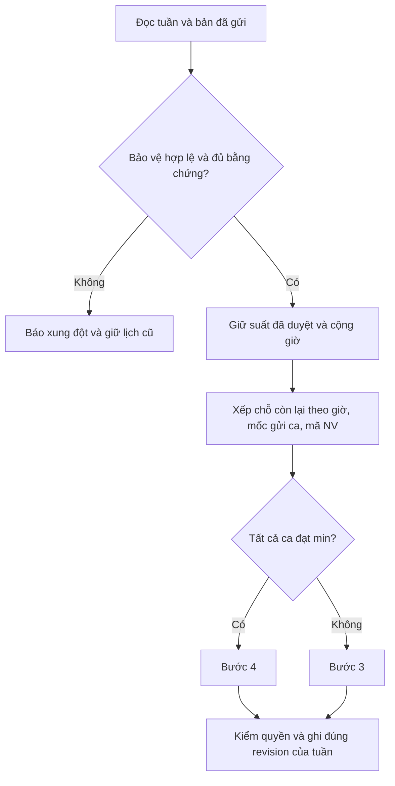

# 2CE Coffee · Bản kỹ thuật bàn giao ngày 01/11/2026

**Phạm vi:** mã nguồn và cơ sở dữ liệu thử cục bộ. Các quy tắc từng chờ quyết định về gửi đơn, giữ suất và phân xử hòa đã được chủ dự án chốt trong yêu cầu cuối và được triển khai. [Bản audit trước khi đổi luật](2CE-REVIEW-BEFORE-SUBMITTED-PLANS.md) lưu bằng chứng trước/sau, các trường hợp tái hiện cũ, đối chiếu BPMN và cuộc đua gán tài khoản. Checklist thực hành nằm ở [HANDOVER-TO-STUDENT.md](../HANDOVER-TO-STUDENT.md).

## 1. Tổng quan hệ thống 2CE

Lịch được lưu độc lập theo thứ Hai đầu tuần. Một ô ca có thể có bốn trạng thái liên quan tới cùng một người: đang chọn nháp, đã gửi đăng ký, đang chờ duyệt bổ sung hoặc đã được phân công. Chỉ **phân công** là kết quả lịch. Đây là giờ dự kiến. Hệ thống không ghi công thực tế, tính lương hoặc suy diễn giờ thực làm.

Trình duyệt gọi API Node cùng origin. Backend xác thực danh tính, kiểm role và tính kế hoạch. Supabase Auth xử lý mật khẩu, PostgreSQL lưu dữ liệu và kiểm quyền trong giao dịch. Demo dùng cùng handler/SQL với PGlite và danh tính local. [Handler](../../server/handler.cjs) · [adapter Supabase](../../server/supabase.cjs) · [demo](../../scripts/offline-demo.cjs)

## 2. Nhân viên làm gì?

- Bước 1 chọn/bỏ ca phù hợp bộ phận. Thao tác lưu **nháp**. Gửi hợp lệ khi bản nháp có ít nhất 20 giờ và 2 tối. Gửi lại thay thế đúng snapshot của người/tuần. Các ca còn giữ không mất thứ tự ưu tiên. Nếu sửa nháp đến mức không đủ điều kiện thì vẫn giữ nguyên bản hợp lệ trước đó.
- Bước 2 theo dõi lịch xếp. Bước 3 chọn ca bổ sung và gửi 1 hoặc nhiều ca trong một thao tác. Mỗi ca tạo một đơn chờ riêng; có thể rút đơn chờ của mình. Chỉ khi duyệt mới có phân công bảo vệ. Không cần đủ chỉ tiêu tuần để giữ suất bổ sung đã được duyệt.
- Bước 4 gửi đơn nghỉ/đổi có lý do cho ca đã giao. Đích đổi phải thuộc đăng ký đã gửi và phù hợp bộ phận. Lịch sử đơn cũ thể hiện quyết định tại thời điểm xét. Ca sau đó được rút/đổi hợp lệ sẽ có quyết định mới và không còn hiển thị như phân công hiện hành.
- Chỉ nhận dữ liệu cá nhân và các số tổng theo ca. Không có đăng ký tùy khoảng giờ, mức trần mong muốn hay chọn người thay trực tiếp. [Giao diện nhân viên](../../app.js) · [visibleWorkspace/applyAction](../../server/workflows.cjs)

## 3. Quản lý làm gì?

Xem 21 ô ca, đủ/thiếu theo bộ phận, số ca đã gửi, trạng thái các bản đăng ký và đơn cần xét. Manager chuyển bước, chạy xếp hoặc xếp lại, duyệt hoặc từ chối. Việc duyệt chiếm chỗ dựa trên dữ liệu mới nhất. Khi xếp lại, nếu bảo vệ không còn khớp người/bộ phận/suất đã lưu, API trả xung đột để đối soát, giữ nguyên lịch và revision. Chưa có kéo thả phân công hoặc giao diện sửa quota.

## 4. Admin làm gì?

Admin tạo/liên kết tài khoản với mã nhân viên tồn tại, đặt role và khóa/mở tài khoản khác. Không tự sửa quyền, không quản trị danh mục ca hoặc chạy xếp. Demo offline cho xem danh sách, trả 501 nếu thử ghi; backend thật dùng Admin Auth API và RPC manage_profile. Phần thật đã kiểm local bằng adapter/SQL, chưa kiểm trên hosted Auth. [Mã admin](../../server/supabase.cjs) · [kiểm tra quyền](../../tests/backend/admin.test.cjs)

## 5. Bảng phân quyền chi tiết

| Chức năng | Employee | Manager | Admin |
|---|---|---|---|
| Mở phiên/đăng xuất | Có | Có | Có |
| Xem lịch tuần | Cá nhân + định biên tổng | Toàn tuần/cửa hàng | Không |
| Sửa nháp, gửi tuần, gửi/rút bổ sung | Chỉ chính mình, đúng bước | Không | Không |
| Gửi yêu cầu nghỉ/đổi | Nguồn đã phân công cho mình | Không | Không |
| Duyệt/từ chối, chuyển bước, chạy máy/phát hành | Không | Có | Không |
| Tạo, khóa, phân quyền và liên kết tài khoản | Không | Không | Tài khoản khác |
| Nhật ký | Lịch sử đơn cá nhân | Đơn qua API tuần, quyền đọc audit theo RLS | Audit qua RLS; không có UI toàn bộ log |
| Gọi RPC ghi bằng credentials trình duyệt | Không | Không | Không |

Provision hàng loạt là thao tác operator ngoài UI. Xem [ma trận mở rộng trước đây](2CE-REVIEW-BEFORE-SUBMITTED-PLANS.md#5-bảng-phân-quyền-chi-tiết) và [kiểm tra role tại server](../../server/workflows.cjs).

## 6. Quy trình hoạt động từ đầu đến cuối

| Luồng | API, dữ liệu và quyết định |
|---|---|
| Đăng nhập/đăng xuất | POST/GET /api/auth, cookie phiên, profile hoạt động. Sai danh tính/quyền thì không vào chức năng. Logout thu hồi phiên ứng dụng |
| Đăng ký tuần | POST /api/action registration ghi shift_registrations (bản nháp), đánh dấu cần gửi. submit kiểm ngưỡng và ghi registration_submissions.submitted_shifts. PostgreSQL đóng dấu mili-giây UTC cho **ca mới** trong giao dịch gửi thành công |
| Xem tuần | GET /api/workspace đọc workspace_snapshot theo thứ Hai. Employee chỉ thấy snapshot/bản nháp/đơn chi tiết của mình. Manager xem toàn tuần |
| Xếp lịch | generate yêu cầu Manager, bước 1–3, hết đơn chờ, đúng revision. plan mới ghi vào shift_assignments của p_week. Lịch thiếu về bước 3, đủ min tự sang bước 4 |
| Bổ sung | submit(shiftIds) lưu các change_requests. Không ghi đè snapshot tuần đã gửi. Manager approve thêm ca vào bản đã gửi và assigned, ghi protected_shifts[ca] = UUID đơn, ghi approval_history/audit_logs. reject/withdraw giữ lịch |
| Đổi/nghỉ | request rồi approve/reject với validate nguồn/đích, nghề, giờ/tối đã gửi, tình trạng bận và quota. Khi Manager duyệt đơn của chủ suất, giải phóng khóa nguồn và ghi UUID bảo vệ đã giải phóng trong audit. Đổi suất bảo vệ sang đích thì đích được bảo vệ bằng đơn đổi đã duyệt. Không kéo một đối tác đang có suất bảo vệ ra khỏi suất đó để đổi chéo |
| Xuất bản và phục hồi | Cho phép xác nhận khi phát hành thiếu; vẫn cho mở lại tuần. Có lỗi DB thì rollback; conflict → tải lại và quyết định lại. Sau commit UI nạp lại lịch; không tự gửi lại lệnh ghi với UUID mới |

[Workflow](../../server/workflows.cjs) · [duyệt và thay người](../../server/approvals.cjs) · [snapshot/commit mới](../../supabase/migrations/202611010003_submitted_plans.sql)

## 7. Thuật toán xếp lịch — giải thích từng bước

Đường chạy hiện hành là [server/planning.cjs](../../server/planning.cjs). Ba ca sáng/chiều/tối cố định, thời lượng 4/4/6 giờ. Bếp chỉ chiều/tối, Phục vụ chỉ tối, Pha chế cả ba. Quota Bếp/Phục vụ/Pha chế: sáng 0/0/1, chiều 1/0/1–2, tối 2/2/2–3. Không có trần giờ tuần khác trong mã. Hai ca kề nhau trong ngày được phép, các khung không đè lên nhau.

```text
lấy riêng tuần và kiểm quyền, revision, đơn chờ
nếu có hồ sơ lịch cũ cần xác nhận → báo conflict
giữ tất cả suất bảo vệ cùng tuần, kiểm nguồn/bộ phận/quota, cộng giờ
với chỗ thường: lọc bản đã gửi hợp lệ ≥20 giờ và ≥2 ca tối
thứ Hai → Chủ nhật; từng ngày tối → chiều → sáng:
  theo bộ phận, lấy người còn đủ điều kiện đến max sau các suất đã giữ
  ưu tiên người dưới 20 giờ; nếu cả hai dưới 20, so số giờ đã xếp
  nếu cùng dưới và hòa giờ, hoặc cả hai đã đủ 20: ai gửi chính ca này trước
  hòa thời gian → mã NV tăng dần
kiểm min từng ca → công bố nếu đủ, mở bổ sung nếu thiếu
commit riêng tuần cùng audit, giữ toàn bộ tuần khác
```



## 8. Ví dụ thực tế về đăng ký và xếp lịch

Trên 18 nhân viên mẫu, demo khởi tạo rõ 73 lựa chọn thuộc các bản **đã gửi**. Mốc gửi lịch sử không có, dùng nhóm thời gian cũ chung và mã NV khi hòa. Kết quả chạy local là 65 phân công. Bảy người dưới 20 giờ là NV01 16h, NV03 16h, NV04 14h, NV05 18h, NV06 16h, NV17 16h và NV18 16h. Tối thứ Hai thiếu một Bếp, tối thứ Năm thiếu một Bếp và một Phục vụ, tối thứ Sáu thiếu một Phục vụ. [Dữ liệu ví dụ](../../scripts/submitted-demo.cjs)

Hai trường hợp test phân biệt rõ luật mới. (1) Hai Bếp tranh chiều Chủ nhật, NV01 đã có 22h, NV02 có 20h. Nếu NV01 gửi ô đó trước thì NV01 nhận. Đổi riêng thứ tự thời điểm gửi thì NV02 nhận. Đảo mảng người/danh sách nháp không đổi quyết định. (2) NV01 chỉ xin thêm một chiều 4 giờ và được duyệt. Manager xếp lại vẫn giữ NV01 dù người này chưa đủ 20/2 để cạnh tranh chỗ thường. [Các phép thử](../../tests/backend/final-planning.test.cjs)

## 9. Luồng phê duyệt và các quyết định XOR

Ba loại đơn là bổ sung, đổi và nghỉ. Rút đơn bổ sung thuộc nhân viên; duyệt/từ chối thuộc Quản lý. Còn chỗ khi gửi không đảm bảo còn chỗ khi duyệt. Ca thiếu sau khi duyệt nghỉ có thể để trống nếu không có người thay đủ điều kiện. XML BPMN có bốn trang, bản TO-BE có bốn điểm rẽ XOR và hai điểm hợp. Hai lane Nhân viên và Quản lý khác với ba role kỹ thuật của ứng dụng. [Đối chiếu gốc, ID gateway và giới hạn sơ đồ](WORKFLOW-BPMN-2026-10-31.md). Không xác nhận đáp ứng rubric hay thay người học viết báo cáo môn học.

## 10. Kiểm tra UX/UI

Layout giữ lịch 7/3/1 ngày theo desktop/tablet/mobile, skeleton theo vùng đang chờ, lỗi tải lại, form modal có vòng focus và Escape. Đã gửi, nháp chưa gửi và ca được giữ chỗ có chữ giải thích. Nút Gửi bị khóa nếu chưa đủ điều kiện hoặc bản hiện tại đã gửi. Danh sách ca đổi chỉ gợi ý đích đã gửi. Manager thấy số người đã gửi và cảnh báo thiếu; thử ghi thất bại không báo thành công giả. Chrome local kiểm 27 tổ hợp vai trò/kích thước; chưa chứng minh trải nghiệm Safari/iPad thật hoặc toàn bộ trình đọc màn hình.

## 11. Kiểm tra Backend, Supabase và bảo mật

Giữ HttpOnly, SameSite, Secure trên HTTPS, mã hóa token AES-GCM, giới hạn lần thử đăng nhập, CSRF cùng origin, lọc payload/role tại server và RLS. Staging dùng phone identifier → email nội bộ HMAC → password grant; không gửi email/SMS. CLI local tắt tự signup, Dashboard của bên nhận cần kiểm lại.

Migration actor binding (202611010002) vẫn trong lịch sử. Bản RPC mới giữ cùng chữ ký, khóa profile và so employee_id do server xác định **trước** ghi/replay. Tài khoản chuyển NV01 → NV03 trước commit của NV01 bị 409. Cùng tuần còn có khóa revision, giới hạn một đơn chờ/ca/người và kiểm idempotency. Snapshot mới nằm trên bảng hiện có nên vẫn theo RLS nhân viên/tuần. Auth và profile khi provision vẫn là hai thao tác khác nhau. [Hồi quy ownership](../../tests/backend/actor-binding.test.cjs) · [phân tích provisioning](PROVISIONING-SAFETY-2026-11-01.md)

## 12. Các lỗi phát hiện và mức độ nghiêm trọng

| Vấn đề | Trạng thái bản bàn giao |
|---|---|
| High · Nhầm người khi đổi liên kết trong lúc ghi | FIXED / WORKING local, giữ guard trong migration mới |
| High · Ca bổ sung đã duyệt mất khi xếp lại | FIXED / WORKING local, giữ trước suất và rollback khi xung đột |
| Medium · Nháp được xếp hoặc cờ đã gửi tồn tại sau sửa | FIXED / WORKING local, tách bản nháp và snapshot đã gửi |
| Medium · Đảo input đổi người thắng | FIXED / WORKING local, thời điểm gửi từng ca + ID |
| Medium · Form đổi cho chọn đích chưa gửi | FIXED ở danh sách lựa chọn và validation server |
| Medium · Cấp tài khoản cloud có thể gián đoạn giữa Auth/profile | PARTIALLY WORKING, tool kiểm tra và dừng để đối soát, hosted NOT VERIFIED |
| Medium · Tuần cũ thiếu chứng cứ bản đã gửi | Có bảo vệ dữ liệu. Cần xác nhận lại hoặc đối soát khi không phục hồi được an toàn |

## 13. Các sửa đổi đã thực hiện

Mã nghiệp vụ chính: [planning](../../server/planning.cjs), [workflows](../../server/workflows.cjs), [approvals](../../server/approvals.cjs), [UI](../../app.js). Thêm migration **202611010003_submitted_plans.sql** sau bốn bản trước. Schema lưu bản đã gửi, khóa ca theo UUID quyết định và cờ cần xác nhận. Mốc gửi được server DB đóng dấu khi lưu đơn tuần; gửi lại giữ mốc của từng ca còn liên tục trong snapshot. Bổ sung dùng thời điểm gửi đơn bổ sung, không dùng lúc Manager bấm duyệt.

Nâng cấp giữ nguyên phân công, đơn và audit cũ. Khôi phục bản gửi tuần nếu gán được hành động gửi và có bằng chứng danh sách chưa bị sửa sau đó. Dữ liệu cũ thiếu chứng cứ giữ nháp/lịch cũ và yêu cầu xác nhận trước khi xếp lại. Những mốc lịch sử không suy ra được để null (nhóm đã có từ trước, hòa dùng ID), không lấy lúc migrate làm giờ gửi. Dựng lại khóa từ đơn bổ sung đã duyệt có xét các quyết định rời ca sau đó.

## 14. Kết quả kiểm thử

| Đã chạy | Đạt | Lỗi | Bỏ qua |
|---|---:|---:|---:|
| Nhóm trọng tâm đầu tiên, gồm planning/approval/actor binding | 51 | 0 | 0 |
| Nhóm kiểm tra sau bổ sung test nâng cấp dữ liệu | 17 | 0 | 0 |
| Toàn bộ Node local: tests/backend/*.test.cjs và tests/audit/*.test.cjs | **119** | **0** | **0** |
| Chrome: tests/backend/browser.cjs | **23** | **0** | **0** |

Các nhóm trọng tâm nằm trong full suite, không cộng dồn. Có kiểm chọn nháp, resubmit, timestamp thật từ giao dịch, đảo input, hai tuần độc lập, bảo vệ ca, xung đột quota, duyệt/rút, lỗi quyền/RLS, 409 khi gán lại người, hồ sơ cũ và rollback. Browser có 27 tổ hợp role/viewport và 0 lỗi runtime. DB local là PGlite; Supabase Auth dùng fixture. Không chạy live test, không ghi SQL cloud, không provision, không triển khai Vercel.

## 15. Những tính năng còn thiếu hoặc chưa hoàn chỉnh

Chưa có deadline tự động, thông báo đẩy giữa hai cửa sổ, ca tùy giờ, màn sửa quota, hoàn tác lịch cũ theo từng revision, quản lý chấm công/lương hay tối ưu công bằng nhiều tuần. Có thể xem **tuần khác** sau khi xếp tuần mới. Trong cùng một tuần chủ động chạy lại sẽ thay phân công chưa được bảo vệ, không tạo một bản lịch lịch sử bất biến cho từng lần chạy. Cấu hình hosted, refresh thật, RLS JWT thật, backup và phục hồi thật chưa xác minh.

## 16. Những việc cần người chủ dự án MIS3047 tự quyết định

Chọn bản BPMN được dùng chính thức, deadline và đường xử lý khi không ai nhận ca thiếu, ai chịu trách nhiệm khi xác nhận công bố lịch thiếu/rỗng, và phương án vận hành cho tuần cũ cần đối soát. Quy tắc gửi đơn, ưu tiên và giữ suất bổ sung đã triển khai theo quyết định của chủ dự án. Hai role nghiệp vụ và Admin kỹ thuật không tự chứng minh đủ số người tham gia theo rubric.

## 17. Đánh giá mức độ sẵn sàng bàn giao

**READY FOR CODE HANDOVER · READY FOR LOCAL DEMO · CLOUD DEMO NOT YET VERIFIED.** Bắt đầu bằng [README](../../README.md), demo local, sau đó mới dùng project staging của người nhận với sự cho phép tương ứng. Khi chuyển phiên bản phải nâng cả schema và backend. Tiến trình demo cũ giữ backend cũ trong bộ nhớ; hãy dùng tiến trình mới sau khi lưu kết quả cần giữ.
