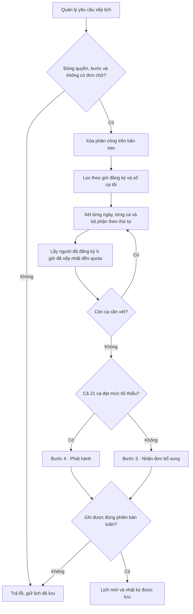

> **Bản lưu trước khi áp dụng các quy tắc cuối.** Giữ số liệu và cách tái hiện của lần audit trước. Xem [bản bàn giao hiện tại](2CE-FULL-SYSTEM-REVIEW.md).

# 2CE Coffee · Kiểm tra toàn hệ thống và hướng dẫn bàn giao MIS3047

**Ngày 01/11/2026 · Phạm vi là bản mã đang làm việc trên máy.** Commit nền là `9e04314`. Trong thư mục hiện có nhiều thay đổi sau commit này, gồm cả quy trình duyệt đăng ký bổ sung. Người nhận chỉ lấy commit nền sẽ thấy hành vi khác. Không dùng tài khoản thật hoặc số liệu nhân sự thật trong phép thử.

**Cập nhật sau audit (01/11/2026).** Đã sửa S1 và kiểm tra trên PostgreSQL nhúng local. Bốn quyết định về tính lịch và việc gửi đơn nằm ở mục 16. Các trạng thái hosted vẫn là NOT VERIFIED.

**Cách đọc kết quả.** WORKING = chạy được trong phạm vi ghi rõ. PARTIALLY WORKING = chỉ đáp ứng một phần. BROKEN = quan sát được hành vi sai hoặc mâu thuẫn với chức năng đang trình bày. NOT IMPLEMENTED = không có chức năng tương ứng trong mã đã kiểm. NOT VERIFIED = thiếu bằng chứng vận hành. Mức High/Medium/Low ở mục 12 là mức tác động khi dùng cho quán. Một chính sách chưa thống nhất được ghi riêng với một lỗi phần mềm.

## 1. Tổng quan hệ thống 2CE

Một tuần, quán phải biết ai rảnh ca nào, cần bao nhiêu người Bếp, Phục vụ, Pha chế và ai được phép thay đổi lịch. 2CE gom bốn việc vào cùng một lịch tuần: nhân viên khai ca rảnh, quản lý chạy xếp ca, hai bên xử lý chỗ thiếu và theo dõi yêu cầu sau khi có lịch. Ví dụ, NV01 chọn tối thứ Ba mới chỉ tạo **đăng ký**. Tên NV01 trong **phân công** của ca đó mới là kết quả xếp. Riêng đợt bổ sung còn có **đơn chờ duyệt** ở giữa hai việc này.

| Khi người dùng làm việc | Phần nào đảm nhiệm | Nguồn để người tiếp quản tìm lại |
|---|---|---|
| Nhập số điện thoại, mật khẩu, đổi tuần, bấm chọn ca | HTML/CSS hiển thị, JavaScript gọi API cùng địa chỉ và vẽ lại kết quả máy chủ trả về | [Màn hình](../../index.html), [app.js — api, enterSession, refreshWorkspace, runAction](../../app.js), [style.css](../../style.css) |
| Kiểm tra danh tính và quyền thực hiện | Điểm vào Node tạo backend, handler đọc cookie, kiểm tra người dùng, vai trò, nội dung và phiên bản lịch | [Điểm vào API](../../api/%5Broute%5D.js), [handler](../../server/handler.cjs), [validation](../../server/validation.cjs) |
| Đăng nhập thật | Supabase Auth kiểm tra mật khẩu. Server tìm profile cùng UUID và phát cookie phiên ứng dụng | [SupabaseBackend.login, authenticate, logout](../../server/supabase.cjs), [ánh xạ định danh staging](../../server/demo-auth.cjs) |
| Tính lịch, chấp nhận hoặc từ chối thao tác | Node chạy quy tắc trên bản sao lịch tuần. Trình duyệt dùng chung một số phép tính để hiển thị | [applyAction, visibleWorkspace](../../server/workflows.cjs), [engine](../../shared/domain.js), [approve, capacity](../../server/approvals.cjs) |
| Ghi nhận kết quả | PostgreSQL khóa phiên bản tuần và ghi kết quả cùng nhật ký trong một giao dịch. RLS giới hạn những dòng đọc được khi truy cập bằng quyền người dùng | [Schema, RLS và RPC ban đầu](../../supabase/migrations/202610310001_backend.sql), [thay đổi cho đơn bổ sung](../../supabase/migrations/202611010001_supplement_requests.sql) |

**Dữ liệu lưu ở đâu.** `auth.users` thuộc Supabase Auth. Trong schema ứng dụng có 12 bảng. `profiles` giữ số điện thoại, vai trò, trạng thái và liên kết nhân sự. `employees` giữ tên, mã NV, bộ phận. `weekly_schedules` giữ thứ Hai đầu tuần, bước, phiên bản. `shifts` định danh từng ca theo tuần. `shift_registrations` giữ ca đã đăng ký và thứ tự. `shift_assignments` giữ người được xếp. `registration_submissions` giữ cờ đã gửi, bị loại và lý do. `change_requests` giữ đơn, ca nguồn/đích, lý do, trạng thái. `approval_history` giữ quyết định của Quản lý. `audit_logs` ghi tác nhân và thao tác. `web_sessions` giữ phiên ứng dụng và token mã hóa. `login_limits` đếm lần thử đăng nhập.

**Hai môi trường phải phân biệt.** Demo trên máy dùng PGlite, áp SQL vào cơ sở dữ liệu thử trong bộ nhớ và dùng bốn danh tính mẫu. Các thao tác lịch đi qua handler và giao dịch thật của ứng dụng. Tải lại trang vẫn còn lịch, khởi động lại tiến trình sẽ tạo lịch mẫu mới. Ở bản tích hợp, Auth và các bảng đặt trên Supabase. Việc chạy demo không xác nhận Auth, cấu hình Dashboard, email provider, sao lưu hoặc khả năng khôi phục của staging. [Máy chủ demo](../../scripts/offline-demo.cjs) · [Bộ chuyển tiếp dữ liệu thử](../../tests/backend/helpers.cjs)

## 2. Nhân viên làm gì?

**WORKING.** Khi đăng nhập, nhân viên thấy tuần đang chọn, tên và bộ phận, thông báo bước, lịch ca, tiến độ giờ/tối, ca được phân công và lịch sử yêu cầu của mình. Họ đổi tuần được. API trả thông tin đủ/thiếu tổng hợp của từng ca và chỉ giữ ID của chính người đó trong danh sách đăng ký, phân công, hồ sơ và đơn. Họ xem được ca mình đã được xếp cả trước khi lịch chính thức phát hành. [renderEmployeeView](../../app.js#L433) · [visibleWorkspace](../../server/workflows.cjs)

- **Bước 1.** Bấm chọn hoặc bỏ ca đúng bộ phận. Mỗi lần bấm đã lưu riêng trên server. Muốn gửi đơn tuần phải đạt ít nhất 20 giờ và 2 ca tối đã đăng ký. Sau khi gửi vẫn sửa được trong bước 1. Chưa có nút rút riêng toàn bộ đơn tuần. Cờ “đã gửi” không tự xóa khi sửa.
- **Bước 2.** Cổng đăng ký tuần đóng. Màn hình chuyển sang đếm giờ **được xếp**. Nếu mới bấm chốt mà chưa chạy thuật toán, con số có thể là 0 dù đăng ký còn nguyên.
- **Bước 3.** Chọn một hoặc nhiều ca bổ sung phù hợp, bỏ chọn trước khi gửi. Bản nháp ở bộ nhớ trang, đổi tuần hoặc tải lại sẽ mất. Gửi một lần tạo một đơn chờ cho mỗi ca. Được rút đơn của mình khi chờ. Quản lý duyệt từng ca. Chỉ ca được duyệt mới vào lịch cá nhân.
- **Bước 4.** Từ ca thuộc lịch đã phát hành, gửi đơn nghỉ hoặc đổi, điền lý do, chọn ca đích nếu đổi. Nhân viên không tự xóa phân công hoặc chỉ định người thay. Kết quả duyệt/từ chối xuất hiện trong lịch sử sau khi tải lại. Không có thông báo đẩy, SMS hay email báo lịch.
- **NOT IMPLEMENTED.** Mức ưu tiên cá nhân, số giờ tối đa mong muốn, khung rảnh tùy ý, ngày nghỉ lặp lại, nhận ca ngoài ba khung, timer tự đóng đăng ký. Người dùng biểu thị khả năng làm bằng cách chọn từng ô ca, không khai “chỉ rảnh 14–16h”.

Nguồn thực thi: [toggleEmployeeShift, handleEmployeeSubmit, submitChangeRequestForm, withdrawSupplement](../../app.js) · [các nhánh registration/submit/request/withdraw](../../server/workflows.cjs).

## 3. Quản lý làm gì?

**WORKING.** Dashboard có 21 ô ca, danh sách nhân sự, tên người được xếp theo ca, trạng thái đủ/thiếu, danh sách đơn, nút chuyển bước và nút xếp tự động. Bốn thẻ tổng hợp là số ca, số nhân viên, số ca đạt **định biên tối thiểu** và số đơn chờ. Trong bước 1 các ô hiển thị số người đăng ký. API của Quản lý có toàn bộ danh sách ID đăng ký, nhưng bảng chính chỉ liệt kê tên người **được xếp**. Không có màn chuyên xem/chốt từng đơn tuần theo tên. Quản lý có thể duyệt/từ chối từng đơn bổ sung, nghỉ, đổi. Không có chức năng chỉnh lý do hoặc sửa nội dung đơn của nhân viên. [renderManagerView và renderManagerOverview](../../app.js) · [applyAction](../../server/workflows.cjs)

**PARTIALLY WORKING.** “Rà soát” là quan sát bảng, đóng/mở bước, xử lý đơn hoặc chạy lại. Không có kéo thả người vào ô, tự nhận ca bằng tài khoản Manager, khóa một phân công, chọn thủ công người thay, hoặc màn hình mô phỏng kết quả trước khi lưu. Thiếu người sau khi chạy sẽ mở bước 3. Đủ toàn bộ chuyển thẳng bước 4. Quản lý vẫn có thể phát hành thủ công lịch thiếu sau khi xác nhận. Việc xác nhận không sinh bản ghi phân công cho chính Quản lý. Không có báo cáo bảng lương, chi phí, tải Excel/PDF, KPI theo tháng hoặc lịch sử phiên bản để quay lại lịch cũ. [Nút bước và lịch](../../index.html) · [phase/generate](../../server/workflows.cjs)

## 4. Admin làm gì?

**WORKING ở API/SQL local; NOT VERIFIED qua Auth thật.** Admin có trang danh sách tài khoản và form tạo/sửa. Tạo người dùng Auth bằng Admin API rồi liên kết `profiles.id = auth.users.id`. Nếu là Employee thì `profiles.employee_id` phải trỏ đúng một dòng nhân sự hiện có và chưa bị tài khoản khác sử dụng. Ví dụ, tạo tài khoản cho NV05 không tạo thêm người làm Bếp thứ bảy. 18 nhân sự có sẵn từ [migration nhân sự](../../supabase/migrations/202610310002_employees.sql).

Admin đổi tên hiển thị, role, nhân sự liên kết và trạng thái hoạt động của tài khoản khác. Chặn sửa chính mình, đổi điện thoại hoặc mật khẩu qua form sửa. SQL có bảo vệ Admin cuối cùng hoạt động và xóa phiên của tài khoản bị khóa. Khóa profile chặn ứng dụng, không đồng nghĩa xóa Auth user. Ghi quản trị vào `audit_logs`. Admin không có UI quản trị ca, định biên, danh mục phòng ban hoặc màn hình chỉnh sửa bảng nhân sự. Chế độ offline cho đọc danh sách mẫu, ghi bị từ chối rõ ràng. [saveAdminAccount](../../app.js#L1099) · [SupabaseBackend.admin](../../server/supabase.cjs#L112) · [manage_profile](../../supabase/migrations/202610310001_backend.sql#L191)

## 5. Bảng phân quyền chi tiết

“Có” chỉ khả năng thực hiện trong phạm vi ghi ở dòng. “—” là không được API cấp quyền hoặc không có chức năng. **Operator** chạy công cụ tin cậy ngoài giao diện bằng khóa máy chủ. Đây không phải vai trò nghiệp vụ thứ tư.

| Khả năng | Employee | Manager | Admin | Điểm thực thi/trạng thái |
|---|---|---|---|---|
| Đăng nhập, khôi phục phiên, đăng xuất | Có | Có | Có | `/api/auth` · WORKING local |
| Xem lịch, định biên tuần | Cá nhân + số tổng | Toàn quán | — | GET workspace · WORKING |
| Xem danh sách đăng ký, phân công, đơn của người khác | — | Có | — qua workspace | visibleWorkspace · WORKING |
| Xem hồ sơ | Chính mình | Nhân sự qua workspace | Danh sách tài khoản | Profile đăng nhập khác với danh mục nhân sự |
| Chọn/hủy ca bước 1, gửi tuần | Chính mình | — | — | registration, submit · WORKING |
| Chọn/bỏ nháp, gửi bổ sung, rút đơn chờ | Chính mình | — | — | submit(shiftIds), withdraw · WORKING |
| Yêu cầu nghỉ/đổi ở bước 4 | Ca được giao | — | — | request · WORKING, giới hạn đổi ở mục 12 |
| Duyệt/từ chối bổ sung, nghỉ, đổi | — | Có | — | approve/reject · WORKING |
| Chuyển bước, xếp lại, xác nhận phát hành thiếu | — | Có | — | phase/generate · WORKING, chính sách mở |
| Tự gán người vào ô, sửa đơn thay người khác | — | — | — | NOT IMPLEMENTED |
| Tạo/liên kết tài khoản, đổi quyền, khóa/mở | — | — | Tài khoản khác | POST admin + manage_profile · WORKING local |
| Tạo/sửa nhân sự gốc, quota, khung giờ trên UI | — | — | — | NOT IMPLEMENTED |
| Xem kết quả các đơn | Của mình | Danh sách chờ trên UI, toàn bộ trong API tuần | — qua workspace | PARTIALLY WORKING, thiếu trang lịch sử duyệt cho Quản lý |
| Đọc audit/approval trực tiếp bằng quyền SQL đã cấp | — | Có | Có | Hai chính sách SELECT. Không có màn tra cứu hay API nhật ký riêng |
| Tự cấp role, gọi RPC ghi trực tiếp từ trình duyệt | — | — | — | GRANT/RLS, service-only. Có kiểm thử từ chối |
| Provision hàng loạt, khôi phục mật khẩu demo | — | — | — qua UI | Operator, tạo có script. Reset là quy trình vận hành có tài liệu |
| Xuất báo cáo, sửa/xóa nhật ký trong app | — | — | — | NOT IMPLEMENTED |

RBAC tại [createHandler](../../server/handler.cjs), [authorizeAction](../../server/workflows.cjs), [cấp quyền SQL và chính sách đọc](../../supabase/migrations/202610310001_backend.sql#L89), [bài kiểm thử truy cập trực tiếp](../../tests/backend/database.test.cjs). Ba role trong phần mềm không tự chứng minh ba người tham gia trong sơ đồ BPMN.

## 6. Quy trình hoạt động từ đầu đến cuối

Mỗi tuần được định danh bằng ngày thứ Hai. Chưa có tuần trong DB thì snapshot trả lịch trống, mặc định **bước 2**. Tuần demo mở sẵn bước 1 hoặc bước 3 là dữ liệu khởi tạo riêng. Bốn bước là trạng thái được lưu, không phải bốn giao diện độc lập.

| Vai trò, thao tác và điểm vào | Điều kiện và nhánh quyết định trên server | Kết quả, bản ghi, phản hồi và cách xử lý lỗi |
|---|---|---|
| Mọi role nhập số/mật khẩu. `handleLoginSubmit → POST /api/auth` | Chuẩn hóa số, hạn chế lượt thử, Auth kiểm mật khẩu, profile active. Ở staging-email còn kiểm UUID/số/email đã xác nhận | Tạo web_session, đặt cookie, trả profile. Sai đăng nhập báo lỗi. Khi mở lại trang dùng GET auth, thành công vào đúng dashboard |
| Mọi role đăng xuất. `handleLogout → POST /api/auth` | Cùng origin, action logout | Xóa phiên ứng dụng của cookie, làm hết hạn cookie. Replay cookie mất hiệu lực. Nếu dịch vụ lỗi, báo lỗi và cho thử lại |
| Manager mở/đóng tuần. `changeWeekStatus → POST /api/action phase` | Bước 1–4 hợp lệ, khác hiện tại. Bước 4 thiếu người bắt buộc acceptMissing | Ghi weekly_schedules.phase và revision. Đóng tuần chặn chọn/hủy mới qua API. Không có lịch đóng tự động |
| Employee chọn/bỏ ô. `toggleEmployeeShift → registration` | Bước 1, đúng ca và bộ phận, không trùng thao tác, chỉ ID nhân viên từ profile | Thêm/bỏ trong shift_registrations. Tải lại lịch tính giờ mới. Ca sai, quyền sai hoặc revision cũ bị từ chối |
| Employee gửi tuần. `handleEmployeeSubmit → submit({})` | Bước 1, giờ **đăng ký** ≥20, tối ≥2 | Đặt registration_submissions.submitted. Có thông báo thành công. Gửi lại bằng requestId mới vẫn được nếu đủ điều kiện. Không tạo hàng chờ Manager duyệt đơn tuần |
| Manager xem bảng và chạy. `triggerAutoScheduling → generate` | Ở bước 1–3, không còn đơn chờ. Gọi engine trên toàn tuần | Xây lại shift_assignments, cập nhật disqualified/reason. Đủ 21 ca → bước 4, còn thiếu → bước 3. Lưu rồi tải lại, không lưu một “bản xem trước” riêng |
| Employee bổ sung. `handleEmployeeSubmit → submit({shiftIds})` | Bước 3, danh sách 1–21 ca khác nhau, đúng bộ phận, chưa đăng ký/được xếp, chưa có đơn chờ cho ca, còn quota và ca còn thiếu | Mỗi ca một change_request “Đăng ký bổ sung”. Gửi cả danh sách trong một commit. Lỗi một ca thì không gửi lẻ các ca khác. Chưa chiếm suất, chưa vào lịch |
| Employee rút. `withdrawSupplement → withdraw` | Đơn bổ sung của mình còn CHỜ DUYỆT, server không bắt buộc bước 3 để rút | ĐÃ RÚT, ghi audit. Không ghi approval_history như quyết định của Manager. Đã xử lý thì báo xung đột |
| Manager duyệt/từ chối bổ sung. `approveChangeRequest/rejectChangeRequest` | Duyệt cần bước 3, còn chờ và còn chỗ tại thời điểm duyệt. Từ chối đơn bổ sung chờ có thể thực hiện ngoài bước 3 | Duyệt thêm cả registered và assigned, đổi trạng thái, ghi lịch sử quyết định và audit cùng giao dịch. Từ chối chỉ đổi trạng thái. Hết chỗ giữ đơn chờ để Quản lý xử lý |
| Manager phát hành thủ công. `changeWeekStatus(4) → phase` | Nếu bất kỳ ca thiếu, hộp xác nhận phải được chấp nhận và server kiểm cờ. Không kiểm lịch phải có ít nhất một phân công hoặc đã qua các bước trước | Lịch bước 4. Không tự gửi email, không thêm Quản lý vào ô thiếu. Có thể mở lại bước khác |
| Employee xin nghỉ/đổi. `openChangeModal → submitChangeRequestForm → request` | Bước 4, ca nguồn đã giao cho mình, có lý do, chưa có đơn chờ cùng ca. Đổi cần ca đích khác, đúng bộ phận và chưa được xếp | Ghi CHỜ DUYỆT, không đổi lịch. Hiển thị trong lịch sử cá nhân/hàng chờ Manager. Kiểm đăng ký ca đích lúc duyệt chặt hơn lúc tạo |
| Manager xét nghỉ/đổi. `approve/reject` | Bước 4, còn chờ, nguồn vẫn giao cho người xin. Đổi còn phải đáp ứng đăng ký đích, điều kiện 20/2 và quota. Quy tắc tìm người thay ở mục 7 | Duyệt cập nhật ca, đăng ký liên quan, trạng thái, history, audit. Từ chối giữ lịch. Đơn đã xử lý không thể duyệt lần hai. Nếu ghi DB hỏng, toàn giao dịch hoàn tác |
| Admin tạo/cập nhật/khóa. `saveAdminAccount → POST /api/admin` | Kiểm role trên handler và SQL, kiểu dữ liệu, số, mã nhân sự và xung đột liên kết. Tạo mới cần mật khẩu 12–128 ký tự | Auth create trước, manage_profile sau. Với cập nhật profile, thay đổi quyền và audit cùng giao dịch. Xem mục 11 nếu tạo bị gián đoạn |
| Hệ thống ghi và truy vết | Mỗi lệnh lịch có actor, requestId, fingerprint, week, revision. Phải được phép trước cả khi trả kết quả đã lưu | audit_logs ghi ngay trong commit, approval_history thêm khi đơn đi từ chờ đến duyệt/từ chối. Lịch đã đổi → 409, tải lại và quyết định lại. Không tự phát lại thao tác ghi với UUID mới |

Nguồn đường đi: [UI gọi API](../../app.js#L975) → [handler](../../server/handler.cjs) → [quy tắc](../../server/workflows.cjs) → [commit_workspace đang dùng](../../supabase/migrations/202611010002_workspace_actor_binding.sql). Với tài khoản đi qua [SupabaseBackend.admin](../../server/supabase.cjs#L112) và `manage_profile`. Hầu hết phản hồi là thông báo trên trang/hộp thoại hoặc trạng thái đọc lại. Không có đồng bộ đẩy giữa hai cửa sổ đang mở.

## 7. Thuật toán xếp lịch — giải thích từng bước

**WORKING cho việc phân bổ theo quy tắc hiện tại.** Đây là thuật toán tham lam: mỗi lần lấp một chỗ trống bằng ứng viên hợp lệ đang có ít giờ hơn. Không huấn luyện mô hình AI, không gọi dịch vụ AI, không tìm nghiệm tối ưu toàn tuần. Nút của Manager gọi `applyAction('generate')`, hàm này gọi [runSchedulingAlgorithm](../../shared/domain.js#L130). Một chú thích cũ ở chỗ gọi vẫn nhắc bug bước 2, nhưng điều kiện đang chạy đã sửa.

| Ca cố định mỗi ngày | Thời gian | Bếp min–max | Phục vụ min–max | Pha chế min–max |
|---|---|---:|---:|---:|
| Sáng | 09:00–13:00, 4 giờ | 0 | 0 | 1–1 |
| Chiều | 13:00–17:00, 4 giờ | 1–1 | 0 | 1–2 |
| Tối | 17:00–23:00, 6 giờ | 2–2 | 2–2 | 2–3 |

1. **Đọc đầu vào.** Lấy 18 người và bộ phận của họ, 21 ca, danh sách ID đã đăng ký theo thứ tự lưu, cờ trạng thái nhân viên và bước tuần. Lần chạy mới xóa các danh sách *phân công* cũ trên bản sao. Đăng ký vẫn còn.
2. **Lọc người.** `getEmployeeStats` đếm mỗi ca đăng ký một lần. Đăng ký 2 chiều + 2 tối = 4 + 4 + 6 + 6 = 20 giờ và 2 tối. Ít hơn một trong hai ngưỡng thì đánh dấu loại khỏi lần xếp đó. Không yêu cầu cờ đã gửi. Không có trần giờ tuần, trần số ca tối hoặc cân bằng số ca tối giữa các nhân viên.
3. **Tách điều kiện đầu vào và đầu ra.** Ở bước 1, thanh tiến độ dùng `regHours/regEvening`. Từ bước 2, thanh dùng `assignedHours/assignedEvening`. Thuật toán luôn lọc theo **regHours/regEvening**. Nếu lọc theo thanh tiến độ sau khi vừa xóa phân công thì tất cả sẽ bằng 0. Bài regression tái hiện đúng lỗi trước đây.
4. **Chọn theo thứ tự.** Thứ Hai → Chủ nhật. Trong từng ngày xếp **Tối → Chiều → Sáng**. Chỉ những người đã đăng ký đúng ô, còn tồn tại và không bị loại mới vào danh sách. Sắp theo tổng giờ *đã được xếp trong lần chạy này* tăng dần. Khi hòa, cách sắp xếp ổn định giữ thứ tự mảng đăng ký của ô. SQL đọc theo `position`. Hủy rồi đăng ký lại có thể đưa người đó xuống sau.
5. **Lấp theo bộ phận.** Lần lượt Bếp, Phục vụ, Pha chế, thêm đến mức **max** hoặc hết ứng viên. Cộng giờ ngay để ca sau dùng số mới. Bỏ người đã có trong chính ô. `evaluateShiftStaffing` kiểm mức **min** để báo thiếu. “Đủ người” không có nghĩa đã đạt max. Hàm đánh giá này cũng không phải bộ phát hiện dữ liệu vượt max từ nguồn ngoài.
6. **Thời gian và công bằng.** Ba khung giờ cố định không giao nhau, nhưng có thể nối tiếp. Một nhân viên có thể làm chiều và tối cùng ngày. SQL chặn lặp cùng người/cùng ca/cùng tuần. Không có bộ giải trùng khoảng thời gian cho lịch tùy chỉnh, kiểm nghỉ giữa ca hoặc số ngày làm liên tiếp. Người ít giờ được ưu tiên tại thời điểm xét, không có cam kết mỗi người đạt 20 giờ thực nhận. Nhóm dư ứng viên có người không được xếp. Nhóm thiếu vẫn để trống thay vì điều nhân viên ngoài đăng ký.
7. **Ghi và chạy lại.** Đủ min toàn bộ → bước 4, còn thiếu → bước 3. Backend commit revision mới và nhật ký. Cùng dữ liệu **và thứ tự**, kết quả phân công lặp lại. Gửi lại cùng UUID, fingerprint và revision có thể nhận kết quả cũ mà không ghi thêm. Bấm nút lần mới có thể ghi revision/audit mới hoặc bị chặn vì đã phát hành/có đơn chờ. Hai lần gọi API không nhất thiết cho cùng phản hồi như hai lần chạy riêng hàm tính.
8. **Những đường khác cũng thêm người.** Duyệt bổ sung bắt nguồn từ đơn do chính nhân viên gửi, xét chỗ lại rồi thêm đăng ký và phân công trong một giao dịch. Không xét 20/2 ở nhánh này. Khi duyệt nghỉ/đổi, [approve](../../server/approvals.cjs) tìm ứng viên cùng bộ phận, đã đăng ký ca nguồn, đủ **giờ đăng ký** và ca tối, chưa được xếp nguồn, không vướng đơn chờ liên quan và rảnh ngày nguồn (trừ ca đích đang đổi). Ưu tiên đối tác đổi chéo ở ca đích, nếu không có thì lấy ứng viên hợp lệ đầu tiên theo thứ tự danh sách. Với người xin đổi cũng phải có đăng ký ca đích. Kiểm max ở các ca bị ảnh hưởng trước khi áp dụng. Có thể duyệt nghỉ dù không có người thay và để lại chỗ thiếu. Không chạy lại thuật toán toàn tuần trong thao tác này. Các hàm approve cũ trong domain không phải đường duyệt hiện hành của server.

Các ngưỡng, quota, ba khung giờ, thứ tự ưu tiên và tiêu chí người thay đều nằm trong mã. Một số số liệu (như min khi kiểm thiếu) lặp lại trong code và văn bản UI. Những gì người dùng thay đổi được bằng giao diện là tuần, ca đã chọn, bước, đơn và kết quả xét duyệt. Không có màn hình đặt chính sách. [DAYS, SHIFT_CONFIGS, getEmployeeStats và evaluateShiftStaffing](../../shared/domain.js)

**Mã giả của lần xếp tự động**

```text
kiểm tra Manager, bước cho phép, không còn đơn chờ và đúng phiên bản tuần
xóa phân công cũ trên bản sao, đặt giờĐãXếp[mỗi người] = 0
với từng người: hợpLệ = giờĐăngKý >= 20 VÀ sốTốiĐăngKý >= 2
với từng ngày từ thứ Hai tới Chủ nhật:
    với loại ca trong [tối, chiều, sáng]:
        lấy người đã đăng ký ô này và hợpLệ
        sắp ổn định theo giờĐãXếp tăng dần
        với từng bộ phận có quota:
            lấy theo thứ tự đến max, tránh trùng người trong ô
            cộng thời lượng ca cho người vừa nhận
nếu mọi ca đạt min: bước = 4
nếu còn ca thiếu: bước = 3
ghi phân công, bước, kết quả và audit trong giao dịch theo phiên bản
```



## 8. Ví dụ thực tế về đăng ký và xếp lịch

**Đã chạy trực tiếp**, dùng bản sao [demo-data.json](../../scripts/demo-data.json), [danh sách NV01–NV18](../../server/employees.cjs) và `applyAction` với Manager ở bước 2. Đầu vào có 73 lượt đăng ký, 18 cờ đã gửi. Đầu ra có **65 lượt phân công, 0 người bị loại, 11/18 người đạt cả hai mục tiêu sau xếp, 18/21 ca đủ min**, tuần sang bước 3. Chạy lại từ kết quả vừa tính cho cùng phân công. Có thể tái lập trên máy bằng `npm run test:scheduling`.

**Nhìn vào ba quyết định cụ thể:**

- Tối thứ Hai có NV02 (Bếp), NV07/NV08 (Phục vụ), NV15/NV18 (Pha chế). Cả năm bắt đầu ở 0 giờ và đều được xếp. Còn thiếu một Bếp vì chỉ có một Bếp đăng ký tối đó.
- Chiều thứ Hai, NV01 và NV05 cùng là Bếp và đều đang có 0 giờ. Ô này chỉ nhận một Bếp. NV01 đứng trước trong đăng ký nên nhận 4 giờ. NV13 lấy chỗ Pha chế. Phép thử phụ chỉ đảo thứ tự mảng đăng ký của ca này trên bản sao: kết quả đổi từ NV01 + NV13 thành NV05 + NV13.
- Đến tối thứ Bảy, ba Bếp có mặt trong danh sách là NV01 (đã có 16 giờ), NV03 (10), NV04 (8). Hai chỗ về NV04 và NV03. Điều này giúp hai người ít giờ trong lượt đó nhưng NV01 kết tuần ở 16 giờ. Sáng thứ Ba, NV10 có 4 giờ, NV18 có 6 giờ nên NV10 nhận chỗ duy nhất.

**Toàn bộ kết quả theo nhân viên.** Cặp số là *giờ / số ca tối*. Cột cuối đối chiếu đăng ký có thật nhưng không được chọn. Thiếu mục tiêu sau xếp không đồng nghĩa thiếu đăng ký đầu vào.

| Mã | Bộ phận | Đăng ký | Được xếp | Ca đăng ký bị bỏ và nguyên nhân trực tiếp |
|---|---|---:|---:|---|
| NV01 | Bếp | 22/3 | **16/2** | Tối T7, hai Bếp ít giờ hơn |
| NV02 | Bếp | 24/2 | 20/2 | Chiều T7, NV06 ít giờ hơn |
| NV03 | Bếp | 22/3 | **16/2** | Tối CN, hai chỗ về NV06 và NV05 |
| NV04 | Bếp | 20/2 | **14/1** | Tối CN, cùng giới hạn hai chỗ |
| NV05 | Bếp | 22/3 | **18/3** | Chiều T2, hòa 0 giờ với NV01 |
| NV06 | Bếp | 20/2 | **16/2** | Chiều T3, hòa 0 giờ với NV03 |
| NV07 | Phục vụ | 24/4 | 24/4 | Được tất cả ca đã chọn |
| NV08 | Phục vụ | 24/4 | 24/4 | Như trên |
| NV09 | Phục vụ | 24/4 | 24/4 | Như trên |
| NV10 | Pha chế | 20/2 | 20/2 | Như trên |
| NV11 | Pha chế | 20/2 | 20/2 | Như trên |
| NV12 | Pha chế | 20/2 | 20/2 | Như trên |
| NV13 | Pha chế | 20/2 | 20/2 | Như trên |
| NV14 | Pha chế | 20/2 | 20/2 | Như trên |
| NV15 | Pha chế | 20/2 | 20/2 | Như trên |
| NV16 | Pha chế | 20/2 | 20/2 | Như trên |
| NV17 | Pha chế | 20/2 | **16/2** | Sáng T2, hòa 0 giờ với NV10 |
| NV18 | Pha chế | 20/2 | **16/2** | Sáng T3, NV10 ít giờ hơn |

Ba ca còn thiếu là **tối T2 thiếu 1 Bếp, tối T5 thiếu 1 Bếp và 1 Phục vụ, tối T6 thiếu 1 Phục vụ**. Đây là bốn chỗ ở những ngày/bộ phận cụ thể. Không thể lấy tám lượt đăng ký dư ở các ô khác để lấp bốn chỗ này nếu nhân viên chưa chọn đúng ca. Trong mẫu này, cả bảy trường hợp dưới mục tiêu đều có đủ đăng ký ban đầu. Không có bằng chứng bảy người bị loại do trùng giờ hoặc chọn sai chuyên môn. Phân tích khả thi trước đây và các ràng buộc khi cân bằng lại có trong [audit BPMN, mục 5](WORKFLOW-BPMN-2026-10-31.md).

**Lịch đầu ra của đúng lần chạy trên.** Các số trong bảng là phần số của mã NV, ví dụ 02 là NV02. Mỗi ô giữ thứ tự phân công mà hàm trả về.

| Ngày | Sáng | Chiều | Tối |
|---|---|---|---|
| Thứ 2 | 10 | 01, 13 | 02, 07, 08, 15, 18 |
| Thứ 3 | 10 | 03, 14 | 05, 01, 09, 07, 12, 15 |
| Thứ 4 | 11 | 02, 17, 14 | 03, 05, 09, 07, 16, 13, 12 |
| Thứ 5 | 11 | 04, 18, 15 | 01, 07, 16, 10, 13 |
| Thứ 6 | 12 | 04, 15 | 06, 02, 08, 17, 11 |
| Thứ 7 | 12 | 06, 16 | 04, 03, 08, 09, 14, 17, 10 |
| Chủ Nhật | 13 | 02, 16 | 06, 05, 08, 09, 18, 11, 14 |

## 9. Luồng phê duyệt và các quyết định XOR

**XOR** nghĩa là tại một điểm rẽ, quy trình chọn một đường theo điều kiện. Một hình thoi dùng để nhập hai đường trở lại thành một không tạo thêm một quyết định. Đã đọc lại XML diagrams.net trong workspace. Bốn trang là Trang-1 (AS-IS), TO-BE, Bản sao của TO-BE và Page-4. Không thấy rubric chính thức hoặc bằng chứng ký duyệt một trang làm chuẩn. [Sơ đồ gốc](<../../Xếp ca 2CE TO-BE>) · [Các node/edge đã trích](bpmn-extract.json) · [Đối chiếu từng trang](WORKFLOW-BPMN-2026-10-31.md)

| Bốn quyết định thật trên trang TO-BE | Đường vẽ | Đối chiếu hiện tại |
|---|---|---|
| Tất cả ca đã đủ người? (`…-20`) | Đủ → gửi lịch. Thiếu → thông báo thiếu | generate đi 4/3 tương ứng. Manual publish có đường xác nhận thiếu riêng |
| Có nhân viên nhận ca thiếu? (`…-38`) | Có → nhân viên nhận. Không → Quản lý nhận ca. Quay lại xếp | Có gửi/rút/duyệt bổ sung. Không có hành động ghi Quản lý thành người nhận ca. Duyệt một ca cập nhật ngay ô, không tự chạy lại cả thuật toán |
| Có nhu cầu thay đổi? (`…-2` của nhóm 0R5D) | Có → gửi yêu cầu. Không → theo dõi tuần | Form ở bước 4 phản ánh nhánh có. Tiếp tục làm việc không có sự kiện riêng |
| Có thay đổi đột xuất? (`…-8` của nhóm 0R5D) | Có → vào cùng đường gửi yêu cầu. Không → kết thúc | App dùng đơn nghỉ/đổi, không có thao tác đóng vòng đời tuần riêng |

TO-BE và bản sao mỗi trang có sáu ký hiệu exclusive, gồm bốn rẽ và hai hợp. Hai lane nghiệp vụ có tên là **Quản lý** và **Nhân viên**. Start “Lập ca làm việc”, end “Kết thúc”. Bản sao có thêm “Xác nhận nhân viên nhận ca”. Page-4 thêm timer (7 giờ sáng thứ Bảy, 7 giờ sáng Chủ nhật, 5h) và có ba connector thiếu target. Trang TO-BE đặt một số tác vụ xếp/cập nhật ở lane Nhân viên, Page-4 lại đặt ở Quản lý. Không suy diễn điều kiện mặc định hoặc hạn nộp từ connector rời.

**Những quyết định thực sự ở ứng dụng:**

| Điểm quyết định | Điều kiện → kết quả | Bằng chứng |
|---|---|---|
| Được vào chức năng? | Phiên hợp lệ + active + đúng role → tiếp. Sai → 401/403. Payload/tuần sai → 4xx | handler, authenticate, authorizeAction |
| Đăng ký tuần? | Bước 1 + đúng bộ phận + thao tác chưa trùng → lưu. Đủ 20/2 → gửi được | applyAction registration/submit |
| Được xét và nhận chỗ? | Đủ đăng ký 20/2 → vào tập ứng viên. Đúng ô, đúng bộ phận và còn quota → nhận theo thứ tự | runSchedulingAlgorithm |
| Đủ nhân sự? Có được công bố dù thiếu? | Generate đủ → 4, thiếu → 3. Manual thiếu → xác nhận hay dừng | generate/phase, changeWeekStatus |
| Nhận đơn bổ sung? | Bước 3 + hợp lệ → chờ, người gửi có thể rút. Quản lý từ chối → kết thúc. Duyệt + kiểm lại chỗ → phân công | submit/withdraw/approve/reject |
| Chấp thuận nghỉ hoặc đổi? | Từ chối → giữ lịch. Duyệt → kiểm nguồn, đích/quota. Có đối tác đổi chéo → đổi. Nếu không, tìm người thay hợp lệ hoặc để trống nguồn | workflows và approvals |
| Ghi thay đổi? | Đúng phiên bản/quyền → ghi. Cùng thao tác đã hoàn tất → trả kết quả cũ. Trùng UUID khác nội dung, dữ liệu đổi, DB lỗi → xung đột hoặc rollback | handler và commit_workspace |

**Đối với MIS3047:** Có bằng chứng ≥3 điểm XOR nghiệp vụ trên TO-BE. App có ba **loại đơn có thể duyệt hoặc từ chối** (bổ sung, nghỉ, đổi), trong đó nghỉ/đổi chung một cơ chế. Bản sao gần luồng bổ sung được chủ dự án chọn trong trao đổi này hơn, nhưng sơ đồ không vẽ đủ ba cặp nhánh duyệt/từ chối rõ ràng. Đăng nhập và kiểm giờ là kiểm tra điều kiện, không phải cuộc xét duyệt. Hai vai trò nghiệp vụ + một role quản trị kỹ thuật không chứng minh ≥3 lane nghiệp vụ. Trạng thái/đơn/audit lưu bền khi dùng PostgreSQL và đã kiểm giao dịch local. **PARTIALLY WORKING / NOT VERIFIED** cho việc đáp ứng toàn bộ tiêu chí học phần.

## 10. Kiểm tra UX/UI

| Quan sát và phạm vi | Kết quả hoặc khó khăn khi thực hiện công việc | Trạng thái và việc nên làm |
|---|---|---|
| Desktop, tablet, mobile. Chrome chạy ba role tại 9 kích thước từ 320 đến 1920 px | ≥1200 px thấy 7 ngày, 768–1199 px thấy 3 ngày, nhỏ hơn thấy 1 ngày. Không tràn ngang toàn trang ở 27 tổ hợp. Tablet có thẻ tiến độ/gửi đơn bên phải. Đổi hướng màn hình vẫn giữ ngày được chọn | WORKING local. Chưa thử Safari thật trên iPad; 27 tổ hợp là viewport Chrome |
| Chọn ca tuần và bổ sung | Trạng thái chọn/bỏ, giờ/tối, nút gửi và lịch phân công kiểm qua thao tác thật. Ở bước 3 “Chọn ca”, “Chờ duyệt”, “Rút đơn” và “Đã được phân công” là các trạng thái khác nhau | WORKING. Đơn tuần thông thường chỉ báo khi gửi, không có biên nhận bền dễ nhìn tương đương đơn bổ sung |
| Phản hồi chậm, rỗng, lỗi | Skeleton xuất hiện sau 120 ms, giữ kích thước ô. Lịch trống, không có đơn và không có ca đều có thông báo. API lỗi tải lịch có nút thử lại. Thử ép lỗi ghi duyệt không thấy thông báo thành công hoặc cập nhật lịch giả | WORKING ở các đường đã test. Hai màn đang mở độc lập phải tải lại để thấy quyết định mới |
| Đổi ca | Danh sách đích trong openChangeModal lọc bộ phận và đã xếp, thiếu lọc đăng ký đích. E2E gửi được đơn rồi Manager không duyệt được cho đến khi fixture bổ sung đăng ký đích | BROKEN về tính nhất quán, Medium. Nếu chính sách giữ điều kiện đã đăng ký, lọc và kiểm cùng điều kiện ngay khi tạo |
| Nội dung cảnh báo | Mẫu có cả NV dưới mục tiêu và **0 đơn**. Giao diện vẫn quy nguyên nhân thiếu cho “vừa có ca xin nghỉ/đổi”. Khi đủ giờ nhưng thiếu ca tối, badge chung cũng ghi “Thiếu giờ”. Ô bước 3 có thể ghi “Đã đủ người” khi thực chất không tuyển bộ phận đó | BROKEN về thông tin, Low. Nêu riêng giờ, tối, quyền bộ phận và quota, chỉ quy nguyên nhân khi có dữ liệu chứng minh |
| Hành động có hậu quả | Có xác nhận phát hành lịch thiếu. “Xếp ca” làm lại cả tuần và có thể phát hành ngay khi đủ. Hộp thông báo kết quả đến sau thao tác. Không có so sánh trước–sau hay hoàn tác. Nút duyệt không giải thích trước nguy cơ mất chỗ vì người khác vừa duyệt | PARTIALLY WORKING, Medium. Ưu tiên giải thích tác động và hiển thị thay đổi trước khi ghi nếu chủ quy trình yêu cầu |
| Điều hướng và khả năng tiếp cận | Có skip-link, label, nút thật, viền focus, progressbar có tên/giá trị, vùng status/alert, modal với focus ban đầu, chặn Tab ra ngoài, Escape để đóng và logic trả focus. Trên Chrome, Shift+Tab từ nút đóng chuyển tới nút gửi cuối form, Tab quay về đầu, Escape trả focus về ca gốc và Enter mở lại được. Giảm chuyển động được kiểm trên skeleton điện thoại. Chưa kiểm hành trình hoàn toàn bằng bàn phím hoặc đọc màn hình trên thiết bị thật | PARTIALLY WORKING. Cần thử gửi/rút/duyệt bằng bàn phím và VoiceOver, nhất là khi DOM bị vẽ lại sau khi lưu |
| Màu sắc, phân cấp | Thẻ trắng, nền xám, nút nâu cà phê, bo góc, thẻ trạng thái có chữ. Tính tỷ lệ tương phản từ token sRGB: chữ chính/trắng 16,83:1, chữ phụ/trắng 5,07:1, trắng/nâu nút chính 8,39:1, cảnh báo cam 5,33:1, badge xanh 5,04:1. Đây là mẫu vài cặp màu, chưa bao phủ opacity, mọi nền hoặc trạng thái vô hiệu | WORKING cho các cặp đã đo. Không kết luận đạt chuẩn tiếp cận cho toàn trang |
| Admin offline | Form từng nhận phản hồi thành công từ adapter dù không có thay đổi nào, sau đó UI ghi “Đã lưu tài khoản”. Đã sửa để trả 501 với hướng dẫn tiếng Việt | WORKING cho phản hồi lỗi sau sửa; ghi tài khoản trong demo offline là NOT IMPLEMENTED |

Nguồn: [index.html](../../index.html), [style.css](../../style.css), [renderCalendarPresentation](../../app.js#L767), [modal và focus](../../app.js#L828), [browser.cjs](../../tests/backend/browser.cjs). Font bên ngoài có font hệ thống thay thế. Browser suite lần này chặn request của trang ra ngoài origin localhost.

## 11. Kiểm tra Backend, Supabase và bảo mật

| Ranh giới | Hành vi và phạm vi kết luận | Bằng chứng |
|---|---|---|
| Danh tính → người dùng ứng dụng | Số điện thoại được chuẩn hóa, mode staging-email chỉ chạy đúng môi trường và đúng origin Supabase cấu hình, chặn production Vercel. HMAC-SHA256 với khóa riêng tạo địa chỉ nội bộ ở miền .invalid. Auth xác thực email/password. Backend kiểm UUID, email đã xác nhận và số trong profile. Giao diện nhận profile. Đây là số định danh được cấp sẵn, không xác minh quyền sở hữu điện thoại | [demo-auth](../../server/demo-auth.cjs), [login](../../server/supabase.cjs#L53), [kiểm thử identity](../../tests/backend/demo-auth.test.cjs). WORKING với transport giả lập, hosted NOT VERIFIED |
| Cấp tài khoản | Auth user chưa có profile hoạt động chưa thể dùng lịch. UUID Auth ↔ profile, employee_id UNIQUE ↔ nhân sự gốc, role employee bắt buộc có liên kết. Đổi role trong form không biến thành chức danh Bếp/Pha chế. Public signup tắt trong cấu hình local sau sửa. Dashboard thật là cấu hình riêng | [schema](../../supabase/migrations/202610310001_backend.sql), [local Auth config](../../supabase/config.toml). WORKING local |
| Phiên ứng dụng | Cookie ngẫu nhiên 32 byte, HttpOnly, SameSite=Strict, Path=/, HTTPS có Secure và tiền tố __Host-. DB lưu SHA-256 của mã phiên, token AES-256-GCM. Hết hạn tuyệt đối 12 giờ, không hoạt động 30 phút. Kiểm Auth user + UUID + profile active khi dùng phiên, refresh khi access token hết hạn, ghi token theo revision. Logout xóa phiên ứng dụng; JWT Supabase không bị thu hồi toàn cục qua thao tác đó | [authenticate/logout](../../server/supabase.cjs#L68), [session-race](../../tests/audit/session-race.test.cjs). WORKING ở các kịch bản local. Hai refresh token thật cạnh tranh và cấu hình JWT hosted NOT VERIFIED |
| Biên HTTP | Chỉ GET/POST trên đường thích hợp. POST cần đúng Origin, X-2CE-Request, JSON và kiểm sec-fetch-site nếu có. Thân tối đa 16 KiB, danh sách trường cho phép, UUID, số điện thoại, ngày thứ Hai, revision và role được kiểm trước ghi. Xác thực không lấy role/employee_id từ trình duyệt | [handler](../../server/handler.cjs), [validation](../../server/validation.cjs), [http.test](../../tests/backend/http.test.cjs). WORKING |
| Giới hạn thử đăng nhập | HMAC tách khóa theo IP và số điện thoại, bộ đếm bền vững theo cửa sổ 5 phút, tối đa 30/IP, 10/số. Lỗi sai/không tồn tại/khóa/sai mapping trong staging-email có thông báo 401 thống nhất. Hạn chế dò qua thông báo, chưa đo rò thời gian. IP chuyển tiếp trên Vercel phụ thuộc biên proxy | [rateLimit](../../server/supabase.cjs), [consume_login_limit](../../supabase/migrations/202610310001_backend.sql). WORKING local; biên proxy NOT VERIFIED |
| Quyền dữ liệu | 12 bảng có RLS. Chính sách authenticated chủ yếu SELECT, giới hạn theo role/ID. Anon không có quyền đọc bảng nghiệp vụ. Employee truy vấn employee khác không lấy được lịch họ qua API. Profile tự đọc theo UUID có policy riêng, kể cả khi ứng dụng chặn login inactive. Admin/Manager có thể đọc audit qua SQL theo chính sách rộng hơn UI | [RLS](../../supabase/migrations/202610310001_backend.sql#L89), [thử SET LOCAL ROLE](../../tests/backend/database.test.cjs). WORKING local |
| Quyền service | Server dùng key đặc quyền cho workspace_snapshot, commit_workspace, manage_profile và consume_login_limit. Client không được execute các RPC này. Service có thể vượt RLS, nên quyền thật phụ thuộc cả handler, visibleWorkspace và SQL. Quyền key này không đưa vào app.js hay static build. Lộ key sẽ có tác động lớn | [static allowlist](../../scripts/build.cjs), [header CSP](../../server/static.cjs), [SQL grants](../../supabase/migrations/202610310001_backend.sql#L204). WORKING với nguồn và grants được kiểm |
| Ghi đồng thời | Cùng tuần có khóa hàng + revision. Sai revision → 409. Ràng buộc unique/FK/trigger chặn đăng ký lặp, sai nhân sự, sai bộ phận. Một pending trên người/tuần/ca. App kiểm quota trước commit. DB không có constraint chung “assignment phải có registration” hay max quota cho mọi caller đặc quyền. Không được coi ghi trực tiếp bằng service là đường thay thế workflow | [RPC hiện hành](../../supabase/migrations/202611010002_workspace_actor_binding.sql), [approval tests](../../tests/backend/workflow-integrity.test.cjs). WORKING local cho trường hợp S1 sau sửa; DB tin cậy server khi nhận toàn bộ lịch |
| Idempotency và lỗi | POST action dùng UUID + actor + fingerprint gồm tuần/revision/action/payload, kiểm log trước và kiểm lại khi khóa tuần. Replay cùng nội dung không thêm lịch sử. Không bảo đảm yêu cầu mới có UUID mới là cùng ý định. POST admin tạo Auth trước profile, không có cơ chế replay tương đương cho cả hai dịch vụ. Lỗi DB/Auth được chuyển sang thông báo giới hạn, không trả stack hay token cho trình duyệt | [handler](../../server/handler.cjs), [SupabaseBackend.request/admin](../../server/supabase.cjs). WORKING cho command tuần, PARTIALLY WORKING cho admin |
| Provision và phục hồi | Kiểm manifest 1/1/18 và mã nhân viên thực tế, mapping Auth/project, Admin active, mâu thuẫn và audit cũ. Ghi credential bằng tạo độc quyền ngoài repo, mode 0600, file tạm cùng thư mục, sync rồi rename trước tạo Auth. Kiểm ID/identity/confirmed của Auth trả về. Tránh reset hoặc xóa khi chạy lại. File có thể chứa **lượt đã thử** chưa thành tài khoản | [provision](../../scripts/provision.cjs), [credentialWriter/checkExisting](../../scripts/provision-lib.cjs), [audit an toàn](PROVISIONING-SAFETY-2026-11-01.md). WORKING local, cấp tài khoản hosted NOT VERIFIED |
| Nhật ký và riêng tư | Audit lưu actor, UUID thao tác, tuần, fingerprint và kết quả. Lý do nghiệp vụ nằm trong change_requests, không phải password/token. Lượt rút không bị ghi là quyết định của Manager. Chưa có UI tra cứu toàn log, log truy cập/đăng nhập/đăng xuất chi tiết hay chính sách lưu trữ tự động được chứng minh | [commit_workspace](../../supabase/migrations/202611010002_workspace_actor_binding.sql), [manage_profile](../../supabase/migrations/202610310001_backend.sql#L191). PARTIALLY WORKING |

**Nếu bị ngắt khi tạo tài khoản.** Auth có thể đã tạo thành công ngay trước khi mất phản hồi, hoặc trước khi profile/audit bootstrap ghi được. File mật khẩu riêng giúp đối soát nhưng không thay thế kiểm tra UUID, mapping, profile active, employee_id và audit. Script dừng khi thấy orphan hoặc thiếu bằng chứng Admin, không tự xóa/ghép lại. UI Admin tạo mới cũng qua hai dịch vụ và không có file phục hồi như công cụ operator. Cần quyền vận hành riêng để kiểm tra thực tế. Không suy ra cloud đã nhất quán chỉ vì preflight báo ready.

## 12. Các lỗi phát hiện và mức độ nghiêm trọng

Không xác nhận lỗi mức Critical trong phạm vi đã kiểm. Bảng dưới phân biệt hành vi tái hiện được với quyết định nên xử lý thế nào. “Đã sửa” nói về bản mã local hiện tại.

| ID · mức · trạng thái | Bằng chứng tái hiện, hậu quả | Việc xử lý/điều kiện đóng |
|---|---|---|
| S1 · **High trước sửa · FIXED / WORKING local** | Trước sửa, NV01 gửi chọn chiều T4, Admin chuyển tài khoản sang NV03 ngay trước commit và POST vẫn trả 200. Nay handler lấy mã từ profile đã xác thực, PostgreSQL khóa hàng profile bằng FOR SHARE, kiểm active, role và so mã NV trước cả việc nhận replay. Nếu Admin ghi trước → 409, revision tuần, danh sách đăng ký và audit thao tác NV đều giữ nguyên. Nếu lệnh NV ghi trước, đăng ký đã hoàn tất tiếp tục thuộc NV01. | [Handler](../../server/handler.cjs), [migration khóa và đối chiếu mã](../../supabase/migrations/202611010002_workspace_actor_binding.sql), [test race, replay và upgrade](../../tests/backend/actor-binding.test.cjs). Chưa áp lên staging. |
| B1 · **High · PARTIALLY WORKING** | Ca bổ sung đã duyệt có thể mất khi chạy lại. Bản sao tuần bước 3, NV01 chỉ xin chiều T2. Duyệt → có NV01 ở assigned. Generate lại → assigned rỗng vì chỉ có 4 giờ/0 tối đăng ký, đơn vẫn “ĐÃ DUYỆT”. Dù đạt 20/2, tái phân bổ theo ưu tiên vẫn không cố định một ô cụ thể. [submit/approve/generate](../../server/workflows.cjs), [reset phân công](../../shared/domain.js#L130) | Chủ quy trình chốt liệu ca duyệt được khóa, lịch chỉ là dự kiến đến bước 4, hay phải xác nhận thay đổi khi xếp lại. Không tự thay thuật toán |
| B2 · **Medium · PARTIALLY WORKING** | Đặt riêng NV01 chưa gửi trong mẫu → generate vẫn xếp 3 ca cho NV01. Gửi đơn ở bước 1 hai lần với UUID mới đều thành công. Sau khi bỏ tối T3, NV01 còn 16 giờ nhưng submitted vẫn true. Dấu “đủ tiêu chuẩn” không phải biên nhận bản đăng ký hiện tại. [registration/submit](../../server/workflows.cjs), [lọc eligibility](../../shared/domain.js#L130), renderEmployeeView | Cần định nghĩa gửi là chốt, gửi phiên bản, hay chỉ xác nhận đã xem. Sau đó mới chọn khóa sửa, yêu cầu gửi lại hoặc hiển thị nhãn rõ hơn |
| B3 · **Medium · PARTIALLY WORKING** | Manager có thể nhảy bước hoặc phát hành lịch trống với xác nhận thiếu. Có thể rời bước 3 còn đơn bổ sung đang chờ, khiến nút duyệt không thực hiện được ở bước 4. Còn có thể từ chối, rút đơn hoặc quay lại bước 3. [phase/approve](../../server/workflows.cjs), [contracts.test](../../tests/audit/contracts.test.cjs) | Xác nhận với chủ dự án về bước bắt buộc, điều kiện công bố và xử lý đơn tồn. Không mặc định tất cả tuần đều cần bước bổ sung |
| U1 · **Medium · BROKEN** | Đơn đổi đích chưa đăng ký đi qua UI và được tạo thành CHỜ DUYỆT nhưng quản lý nhận lỗi “chưa đăng ký” lúc duyệt. Browser suite tái hiện cả hai đầu. [openChangeModal](../../app.js#L156), [yêu cầu](../../server/workflows.cjs), [duyệt](../../server/approvals.cjs) | Lọc ca đích và kiểm ngay khi gửi theo điều kiện đã được duyệt, hoặc đặc tả rõ nếu “xin đổi” được dùng để khai thêm khả năng làm. Trong lúc chờ, Manager có thể từ chối đơn sai |
| U2 · **Low · BROKEN** | Bảy người dưới mục tiêu dù dataset không có đơn nghỉ/đổi. Cảnh báo mặc định khẳng định nguyên nhân là vừa xin nghỉ/đổi. Badge “Thiếu giờ” cũng dùng khi chỉ thiếu ca tối. [renderEmployeeView và renderManagerView](../../app.js) | Thay bằng thiếu cụ thể bao nhiêu giờ/tối theo bước. Không suy ra nguyên nhân nghỉ từ con số |
| U3 · **Medium · WORKING sau sửa local** | DatabaseBackend.admin trước đây trả một object thành công nhưng danh sách bốn tài khoản mẫu không đổi. saveAdminAccount chỉ kiểm thành công rồi hiển thị “Đã lưu tài khoản”. Bây giờ thao tác offline trả lỗi 501 bằng tiếng Việt. [adapter](../../tests/backend/helpers.cjs), [regression](../../tests/audit/handover.test.cjs) | Đã sửa đường API offline. Phiên demo đang chạy từ trước cần nạp lại tiến trình mới để dùng mã mới. Có thể bổ sung nhãn chỉ đọc trên form nếu dùng demo để dạy Admin |
| S2 · **Medium · WORKING cho cấu hình local sau sửa; hosted NOT VERIFIED** | Hai cờ enable_signup trong [config CLI](../../supabase/config.toml) ban đầu true, trái thiết kế chỉ cấp tài khoản trước. Có thể tạo Auth user ngoài quy trình nếu dùng cấu hình này. Không tự cấp được profile/role chỉ bằng signup | Đã tắt hai cờ và thêm kiểm tra local. Operator cần xác minh Dashboard ở lần staging được duyệt riêng |
| O1 · **Medium · PARTIALLY WORKING** | Auth và profile/audit bootstrap là các request riêng. Test mô phỏng mất phản hồi, lỗi đĩa, lỗi profile/audit, rồi chạy lại. Tool dừng an toàn nhưng vẫn có thể để lại Auth orphan. Form Admin không có transaction liên dịch vụ hoặc luồng đối soát tự động. [provision-lib](../../scripts/provision-lib.cjs), [SupabaseBackend.admin](../../server/supabase.cjs#L112) | Một operator, thư mục riêng, giữ file đã ghi, đối chiếu UUID trước phục hồi. Thiếu bằng chứng vận hành thật |
| O2 · **Medium · WORKING sau sửa tài liệu; hosted NOT VERIFIED** | Runbook chuẩn bị staging liệt kê hai migration, nhưng bước 3 hiện ghi loại đơn/trạng thái mới và có action withdraw trong RPC thứ ba. Chỉ đếm 12 bảng và 4 RPC sẽ không phát hiện thiếu bản thứ ba | Đã sửa [thứ tự trong runbook](../SUPABASE-STAGING.md). Sau khi được phép cần đối chiếu chính xác phiên bản đang áp dụng |
| O3 · **High cho bàn giao chỉ bằng commit nền · PARTIALLY WORKING** | Tại thời điểm audit, git status có mã Auth staging, migration bổ sung, demo, kiểm thử và tài liệu mới chưa nằm trong HEAD. Người nhận đúng commit nền sẽ không tái tạo được kết quả dưới đây | Chủ dự án rà soát danh sách thay đổi và đóng gói một revision nhất quán, loại bí mật trước khi chia sẻ. Chưa push hoặc tạo commit trong lượt audit |

## 13. Các sửa đổi đã thực hiện

| Tệp trong lượt audit này | Thay đổi và giới hạn |
|---|---|
| [supabase/config.toml](../../supabase/config.toml) | Tắt signup chung và signup email cho cấu hình CLI trong workspace. Signup SMS/anonymous đã tắt. Không đổi schema, migration hoặc cài đặt cloud |
| [tests/backend/helpers.cjs](../../tests/backend/helpers.cjs) | Adapter dùng bởi demo offline trả lỗi có nghĩa khi Admin thử ghi. Backend Supabase thật không đổi |
| [tests/backend/browser.cjs](../../tests/backend/browser.cjs) | Chặn request của trang ra ngoài origin máy chủ bài test, kể cả khi HTML tham chiếu font bên ngoài. Kiểm trực tiếp vòng focus Tab/Shift+Tab, Escape và Enter ở form xin nghỉ |
| [tests/audit/handover.test.cjs](../../tests/audit/handover.test.cjs) | Ba hồi quy có thể chạy lại: cờ signup, ghi Admin chỉ đọc và trường hợp ca liền kề ở bộ nhân sự nhỏ |
| [docs/SUPABASE-STAGING.md](../SUPABASE-STAGING.md) | Bổ sung migration cần cho duyệt/rút ca bổ sung và giới hạn của bước kiểm tra chỉ đếm bảng/RPC |
| Báo cáo này | Đối chiếu mã, số liệu thực thi, vai trò, BPMN và quyết định cần bàn giao |

Các thay đổi trước lượt audit (bản sửa điều kiện xếp bước 2, Auth staging, duyệt bổ sung, skeleton, hướng dẫn provisioning) là **đối tượng đã kiểm**. Không tính chúng là những sửa đổi mới ở mục này. Audit ban đầu giữ nguyên migrations. Lượt sửa S1 tiếp theo chỉ thêm một migration local cho quyền ghi.

### Bản sửa S1 sau audit

1. Handler lấy `p_expected_employee_id` từ **cùng profile** dùng để tính thay đổi. Manager/seed truyền null. Client không có trường để tự xác định người ghi. Fingerprint của Employee gắn với mã NV để tài khoản vừa được liên kết lại không thể dùng UUID cũ như một lệnh của nhân viên mới.
2. Migration **202611010002** thay chữ ký RPC, gỡ đường ghi 8 tham số. Trong giao dịch, đọc và giữ khóa chia sẻ trên hàng `profiles`. Quyền không còn hợp lệ → 403; mã khác → SQLSTATE 40001 → HTTP 409. UPDATE của Admin và commit lịch có thứ tự rõ ràng tại hàng profile; khóa giữ đến cuối giao dịch. Khóa tuần chống ghi đè lịch vẫn hoạt động độc lập. Cả kết quả replay thành công cũng phải qua kiểm tra DB. Hàm mới chỉ cấp EXECUTE cho service_role trong ba vai trò client/service đã kiểm.
3. Migration chỉ thay hàm và quyền thực thi; không hồi tố chuyển đăng ký NV01 thành NV03. Đã dựng DB ở phiên bản duyệt bổ sung trước đó, lưu lịch và đơn chờ, nâng lên bản mới rồi so snapshot/audit trước–sau và duyệt thành công chính đơn cũ.
4. Phạm vi tin cậy: handler và service key là phía được tin để tính kế hoạch; cơ chế này bảo vệ **yêu cầu đang ghi**. Việc gán lại tài khoản vẫn có hiệu lực cho yêu cầu mới được xác thực dưới mã mới. Lệnh Employee từ bản cũ có fingerprint chưa gắn mã sẽ báo xung đột nếu phát lại sau nâng cấp; người dùng tải lại lịch để kiểm tra thao tác đã lưu. Operator phải đồng bộ phiên bản API/RPC khi được phép rollout.

Mã thay đổi gồm [handler](../../server/handler.cjs), [migration](../../supabase/migrations/202611010002_workspace_actor_binding.sql), caller seed trong [script vận hành](../../scripts/provision.cjs) và [demo local](../../scripts/offline-demo.cjs), [adapter DB thử](../../tests/backend/helpers.cjs), fixture SQL/seed của [database tests](../../tests/backend/database.test.cjs), [workflow tests](../../tests/backend/workflow-integrity.test.cjs) và [browser tests](../../tests/backend/browser.cjs). Bổ sung [bộ hồi quy S1](../../tests/backend/actor-binding.test.cjs), cập nhật dấu vân tay handler trong [kiểm tra phạm vi](../../tests/audit/approved-fix-scope.test.cjs), [truy vấn kiểm chữ ký/grant](../../scripts/check-supabase.sql), [hướng dẫn khởi tạo](../../README.md) và [runbook staging](../SUPABASE-STAGING.md).

## 14. Kết quả kiểm thử

| Thực thi trong lượt audit | Đạt | Lỗi | Bỏ qua | Phạm vi |
|---|---:|---:|---:|---|
| Kiểm S1, handover, preflight (`actor-binding.test.cjs`, `handover.test.cjs`, `staging-preflight.test.cjs`) | 13 | 0 | 0 | 6 bài S1 mới nằm trong tổng local bên dưới |
| `node --test tests/backend/*.test.cjs tests/audit/*.test.cjs` | **115** | **0** | **0** | Node 24, fixtures, Auth transport giả lập, PGlite thực thi SQL và RLS |
| `node tests/backend/browser.cjs` | **23** | **0** | **0** | 23 nhóm kiểm tra Chrome hoàn tất, 27 tổ hợp role/viewport bên trong, 0 lỗi runtime ghi được |
| Live Supabase / Vercel | — | — | — | **Không thực thi** theo yêu cầu. Không cộng thành “pass” hay “skip” |

Lần đầu viết test ca liền kề có **2 đạt, 1 lỗi**: fixture giả định cả 18 người đều rảnh thì sẽ có người nhận ca nối nhau; kết quả thực tế của fixture không như vậy. Thu nhỏ tập người rảnh xuống 2 Bếp, 2 Phục vụ, 3 Pha chế, giữ nguyên code xếp lịch. Test cuối xác nhận có ít nhất một người làm hai ca liền kề, mọi khoảng đã giao của mỗi người trong mỗi ngày đều không đè lên nhau. Giới hạn của kết luận là ba khung giờ cố định hiện tại.

| Kiểm tra âm/tình huống thật | Kết quả quan sát và nơi tái lập |
|---|---|
| Employee tự gọi generate/admin, Manager gọi admin, Admin đọc workspace nhân viên, body giả role | Chặn 403/400 theo đường gọi. [HTTP tests](../../tests/backend/http.test.cjs) |
| Sai điện thoại/mật khẩu, profile thiếu/bị khóa, UUID/phone/email lệch, JWT hết hạn, dịch vụ upstream lỗi | Không cấp phiên cho identity lỗi, refresh hoặc thu hồi theo trường hợp, lỗi unavailable không được báo thành công. [demo-auth](../../tests/backend/demo-auth.test.cjs), [session](../../tests/backend/session.test.cjs), [contracts](../../tests/audit/contracts.test.cjs) |
| Ca không hợp lệ, sai chuyên môn, chọn/hủy trùng, vượt quota, đơn trùng, cấp quyền sai | Server chặn. Hai người xin chỗ cuối vẫn có thể cùng chờ. Hai lệnh duyệt cạnh tranh chỉ một commit. [domain](../../tests/backend/domain.test.cjs), [workflow-integrity](../../tests/backend/workflow-integrity.test.cjs) |
| Nút gửi tuần hai lần | Phép thử riêng mục 12: cờ true cả hai lần với hai intent mới. Khác với chống ghi lặp cùng requestId. Sửa sau gửi có thể giữ cờ cũ |
| Xếp lại, lịch trống/thiếu người, hai ca cùng người | Bộ mẫu tái lập 65, trước sửa là 0. Thiếu → bước 3; lịch trống có thể công bố khi xác nhận. Trùng chính ô bị unique, liền kề được phép. [scheduling-regression](../../tests/backend/scheduling-regression.test.cjs), [contracts](../../tests/audit/contracts.test.cjs), [handover](../../tests/audit/handover.test.cjs) |
| Duyệt người không đăng ký, bận trong ngày nguồn, thiếu điều kiện, mục tiêu đầy, đã duyệt rồi | Không gán người thay trái điều kiện. Duyệt/từ chối lần hai bị chặn; lỗi ghi history hoàn tác cả lịch và trạng thái đơn. [workflow-integrity](../../tests/backend/workflow-integrity.test.cjs) |
| Ownership, SQL độc lập và persist | Thử vai trò anon/authenticated trên PGlite. Đọc của người khác không ra dữ liệu trong các ca thử, UPDATE role/RPC ghi bị chặn. Test reload dùng workspace, test khởi động lại DB dùng bảng probe riêng. Không phải bài khôi phục backup cả hệ thống |
| Provisioning lỗi từng phần | Có test viết file, quyền file, đóng handle, lỗi rename/sync, thiếu mã nhân viên, Auth response sai, mất phản hồi, profile/audit thất bại và retry. Chỉ dùng mock/thư mục tạm. [provision.test](../../tests/audit/provision.test.cjs) |
| Đi xuyên UI | Đăng nhập sai/đúng, skeleton chờ, chọn/hủy/gửi tuần, bước 2 chạy thuật toán, bổ sung–rút–duyệt, nghỉ/đổi/từ chối, lỗi ghi không hiện thành công, hết phiên, khôi phục sau lỗi tải. Bài đổi hợp lệ có **thiết lập riêng** bổ sung đăng ký đích vào fixture. Không diễn giải thành tính năng tự tạo đăng ký của app. [browser.cjs](../../tests/backend/browser.cjs) |

Kiểm thử S1 dùng handler và SQL thật trong PGlite, giữ một HTTP request tại ranh giới trước commit, chạy `manage_profile` rồi thả request. Biến thể kiểm cả đổi liên kết sau lần ghi hợp lệ nhưng trước khi replay kết thúc, kiểm khóa tài khoản, đổi role, giả mạo mã từ client và quyền gọi RPC. PGlite chạy SQL trên một kết nối; đã kiểm hai thứ tự quan sát được và kết quả giao dịch, chưa đo tranh khóa vật lý bằng hai connection PostgreSQL độc lập hoặc trên Supabase hosted.

Đã kiểm lại cấu hình signup chung/email/SMS đều tắt **trong tệp CLI local**; phản hồi ghi Admin demo là 501 có thông báo chưa lưu; luồng chọn–rút–duyệt bổ sung vẫn chạy qua trình duyệt và lưu sau reload. Biến trạng thái trên Dashboard thật, migration đã cài, quyền PostgREST và tài khoản thật đều **NOT VERIFIED**. Log lượt kiểm mới: `/tmp/2ce-owner-focused.log`, `/tmp/2ce-actor-full-local.log`, `/tmp/2ce-actor-full-browser.log`. Browser suite dùng dữ liệu thử riêng và chặn request của trang ra ngoài localhost.

## 15. Những tính năng còn thiếu hoặc chưa hoàn chỉnh

| Khả năng | Trạng thái | Ý nghĩa đối với bàn giao |
|---|---|---|
| Lịch khai rảnh tùy giờ, ưu tiên ca, trần giờ, ngày nghỉ liên tục, bất khả dụng theo ngày | NOT IMPLEMENTED | Hiện chỉ biểu thị rảnh bằng chọn ca cố định. Không trình bày 20 giờ như mức trần |
| Danh mục nhiều cửa hàng, ca tự cấu hình, chỉnh định biên trong Admin, nhân viên nhiều kỹ năng | NOT IMPLEMENTED | Một quán, ba bộ phận và một bộ phận mỗi người. Cần thay mã nếu đổi cấu hình nghiệp vụ |
| Deadline tự động, nhắc người chưa nộp, thông báo đẩy cho nhân viên hoặc Manager | NOT IMPLEMENTED | Đổi bước và tải lại trang là cách hoạt động hiện nay |
| Biên nhận có phiên bản cho đơn tuần, quản lý bản nháp bền của ca bổ sung | PARTIALLY WORKING | Có cờ đã gửi tuần và các đơn bổ sung bền sau khi gửi. Chưa biết chính xác phiên bản lựa chọn nào đã được người dùng xác nhận |
| Điều chỉnh thủ công từng ô, khóa ca đã duyệt, hoàn tác/lịch sử phiên bản, Manager trực tiếp nhận ca | NOT IMPLEMENTED | Có audit sự kiện và có các nhánh xét duyệt, không có giao diện sửa lịch tùy ý |
| Công bằng bảo đảm 20/2 sau xếp, báo cáo số giờ/chi phí nhiều tuần, xuất file | NOT IMPLEMENTED | Có thống kê ngắn trong tuần và chỉ báo đủ/thiếu. Mẫu đã cho thấy 7 người dưới mục tiêu |
| Tự đăng ký, OTP, tự phục hồi mật khẩu trong demo | NOT IMPLEMENTED theo phạm vi đã chọn | Tài khoản cấp trước; phục hồi do operator quản lý. Không coi số điện thoại là chứng cứ sở hữu |
| Kiểm chứng hệ thống trên Supabase thật, RLS bằng JWT thật, khôi phục sau mất dữ liệu thật, Vercel | NOT VERIFIED | Có code, SQL và tài liệu; chưa có bằng chứng live trong cuộc audit này |

Bằng chứng phạm vi là danh mục action/API ở [handler](../../server/handler.cjs), [workflow](../../server/workflows.cjs), các bảng và khóa ở mục 1, các form và dashboard trong [index.html](../../index.html), đối chiếu các vai trò ở mục 5. Phần thiếu có thể là giới hạn hợp lý của đồ án; chỉ coi là thiếu yêu cầu chấm điểm khi có rubric hoặc đặc tả đã duyệt.

## 16. Những việc cần người chủ dự án MIS3047 tự quyết định

| Thứ tự | Quyết định cần chốt | Ví dụ nghiệm thu để tránh hiểu khác |
|---|---|---|
| 1 | Chọn phiên bản BPMN chuẩn, xác nhận lane chịu trách nhiệm, rubric và cách đếm workflow duyệt | Chủ dự án chỉ ra đúng trang dùng để nộp, ba loại đơn và đường từ chối nếu thật sự có. Nêu riêng vai trò quản trị kỹ thuật |
| 2 | Ý nghĩa của việc gửi đơn tuần, sửa/rút sau gửi, mở lại tuần | Một người đủ 20/2 nhưng chưa gửi; một người gửi xong bỏ ca còn 16 giờ. Ghi rõ ai được xếp và giao diện phải báo gì |
| 3 | Ca bổ sung đã duyệt có được cố định khi xếp lại? 20/2 áp lúc bổ sung hay chỉ khi chạy máy? | Duyệt 1 ca 4 giờ cho người chưa đủ 20 giờ rồi bấm xếp lại. Chọn một kết quả duy nhất và viết test |
| 4 | Các điều kiện đổi bước, deadline, công bố thiếu/rỗng, xử lý đơn chờ và trách nhiệm Manager nhận ca | Tuần 0 phân công và tuần thiếu 1 Bếp phải hiển thị hành động gì. Nếu Manager nhận ca, cần dữ liệu nhân sự nào |
| 5 | Quota đầy đủ theo bộ phận, đơn vị của ngưỡng 20/2, công bằng và quy tắc nghỉ giữa ca | Hòa 0 giờ tranh 1 vị trí: ưu tiên đăng ký sớm hay chính sách khác? Làm chiều rồi tối cùng ngày có được không? |
| 6 | Đổi ca đích chưa đăng ký, đổi sang ngày đã có việc, đồng ý của người thay và xử lý thiếu sau nghỉ | Đơn nào phải chặn ngay khi nhập? Khi duyệt nghỉ mà không có ai thay, ai chịu trách nhiệm và ai được thông báo? |
| 7 | Khi chuyển liên kết tài khoản, ai chịu trách nhiệm đối soát lịch sử cũ? | S1 đã xử lý quyền ghi trong giao dịch local. Dữ liệu đã ghi hợp lệ trước khi remap tiếp tục thuộc mã nhân viên ban đầu |
| 8 | Mốc nào gọi là “đã bàn giao” và mốc nào mới được dùng tài khoản thật | Ai giữ key, ai vận hành staging, ai xác nhận các ca thử và ký nhận. Dùng dataset giả trước, giữ riêng thông tin cấp tài khoản |

### Bốn quyết định đã tái hiện sau bản sửa S1

Các bước dưới đây đã chạy trên những bản sao dữ liệu riêng qua `applyAction` của server. “Gửi” ở bước 1 là `submit({})`, còn gửi bổ sung ở bước 3 là `submit({shiftIds:[...]})`. Các khuyến nghị là phương án để chủ dự án chọn; mã nghiệp vụ vẫn thực hiện hành vi hiện tại.

**1. Ca bổ sung đã duyệt có được giữ khi xếp lại?**

- **Tái hiện.** Tạo `domain.emptyState(employees)`, đặt tuần ở bước 3. NV01 gửi ca chiều thứ Hai (`mon-after`). Manager duyệt đúng UUID của đơn. Đọc lại được `assigned=['NV01']`. Manager gọi `generate` cùng tuần. Kết quả: registered vẫn có NV01, assigned rỗng, đơn vẫn ĐÃ DUYỆT.
- **Nguyên nhân và hệ quả.** Bổ sung chỉ xét ca còn chỗ và bộ phận. Lần xếp toàn tuần lại xóa phân công cũ và xét 20/2. Ví dụ này chỉ có 4 giờ và 0 tối. Hệ thống giữ lịch sử quyết định đúng ở thời điểm duyệt, nhưng người dùng có thể dựa vào đó để đi làm dù lịch mới đã bỏ ca. [submit/approve/generate](../../server/workflows.cjs) · [runSchedulingAlgorithm](../../shared/domain.js#L130) · [lịch và lịch sử cá nhân](../../app.js)
- **Phương án.** (A) Khóa các ca bổ sung đã duyệt, trừ khi Manager thu hồi bằng thao tác có lý do. Khi xếp lại phải trừ chỗ và tính giờ của người đã khóa trước. (B) Xem duyệt là tạm thời, cho phép xếp lại nhưng hiển thị chênh lệch, cảnh báo và thông báo cho nhân viên. (C) Chặn xếp lại nếu đã có ca được duyệt, cho đến khi các ca này được xử lý rõ ràng.
- **Khuyến nghị để quyết định.** Chọn A nếu thông báo “đã duyệt và thêm vào lịch” là cam kết nhận ca. Đổi lại, các suất khóa có thể giảm khả năng cân bằng giờ. Chủ dự án cần ghi rõ có giữ cả suất của người chưa đủ 20/2 hay bắt buộc xét ngưỡng ngay khi nhận đơn bổ sung.

**2. Phải gửi đơn tuần mới được xếp, hay chọn từng ca đã là đồng ý làm?**

- **Tái hiện.** Sao chép [mẫu 73 đăng ký](../../scripts/demo-data.json), đặt bước 1, giữ nguyên mọi danh sách ca, chỉ đặt `registrations.NV01.isSubmitted=false`. Manager gọi `generate`. NV01 vẫn nhận `mon-after`, `tue-eve`, `thu-eve` (16 giờ).
- **Nguyên nhân và hệ quả.** Mỗi lượt bấm chọn đã ghi vào shift_registrations. Máy xếp lọc theo danh sách đó và số giờ/tối, không đọc cờ submitted. Nhân viên tưởng chưa hoàn tất vẫn có tên trên lịch. [registration/submit](../../server/workflows.cjs) · [lọc ứng viên](../../shared/domain.js#L130) · [nút gửi](../../app.js)
- **Phương án.** (A) Chỉ xếp đơn tuần đã gửi hợp lệ. (B) Xem chọn ca là cam kết, giữ thao tác gửi như biên nhận tùy chọn và giải thích rõ. (C) Cho quản lý đưa bản chưa gửi vào một lần xếp cụ thể, có xác nhận và lưu dấu vết.
- **Khuyến nghị để quyết định.** Chọn A nếu “Gửi đơn” là bước thể hiện đồng ý. Dễ giải thích, nhưng có thể tăng thiếu người khi quên gửi. Cần chốt cách nhắc và cách xử lý tuần đã mở trước khi đổi luật, đồng thời thống nhất với quyết định 3.

**3. Sau khi sửa đăng ký, trạng thái “đã gửi” còn giá trị không?**

- **Tái hiện.** Bắt đầu từ bản sao mẫu ở bước 1. NV01 có 22 giờ và 3 ca tối. Đặt cờ false, bấm gửi → true. Bỏ tối thứ Ba (`registration({shiftId:'tue-eve',selected:false})`). Đọc lại được **16 giờ / 2 tối / submitted=true**. Gửi mới lúc này bị kiểm tra ngưỡng, nhưng cờ của lần gửi trước vẫn còn.
- **Nguyên nhân và hệ quả.** Nhánh submit đặt cờ đúng một lần cho cặp tuần/người. Nhánh sửa ca chỉ sửa danh sách đăng ký. Bảng registration_submissions không liên kết cờ với phiên bản danh sách đã xác nhận. Con số giờ hiện tại và bằng chứng đã gửi có thể nói về hai bộ ca khác nhau. [applyAction](../../server/workflows.cjs) · [registration_submissions](../../supabase/migrations/202610310001_backend.sql) · [renderEmployeeView](../../app.js#L433)
- **Phương án.** (A) Mỗi thay đổi ca thực sự đều đưa đơn về nháp và yêu cầu gửi lại. (B) Khóa sửa sau gửi, thêm thao tác rút/mở lại rõ ràng. (C) Lưu riêng bản đã gửi cùng phiên bản; cho sửa nháp song song và chỉ thay bản có hiệu lực khi gửi bản mới.
- **Khuyến nghị để quyết định.** Với demo hiện tại, A đơn giản nhất và vẫn cho sửa linh hoạt. Nhược điểm là phải gửi lại ngay cả khi số giờ vẫn đủ. Chủ dự án cần chọn bản nào có hiệu lực khi tới hạn và người dùng quên gửi lại. Chỉ xóa cờ khi tụt dưới ngưỡng sẽ bỏ sót trường hợp đổi hai ca cùng thời lượng.

**4. Hai nhân viên hòa số giờ thì ai được ưu tiên?**

- **Tái hiện.** Dùng mẫu gốc bước 2, chạy generate trên hai bản sao. Ở bản A giữ thứ tự `mon-after.registered=['NV01','NV05','NV13']`, ở bản B chỉ hoán đổi NV01 và NV05. Cả hai Bếp đều đang có 0 giờ khi xét và chỉ có một chỗ. Kết quả lần lượt là **NV01 + NV13** và **NV05 + NV13**. Lặp lại với đúng cùng thứ tự cho cùng kết quả.
- **Nguyên nhân và hệ quả.** Comparator chỉ so số giờ đã xếp, sort ổn định giữ thứ tự mảng khi bằng nhau. Snapshot SQL dựng mảng theo position; RPC có thể ghi lại các hàng nhưng giữ thứ tự mảng. Đây là thứ tự tương đối hiện có, không phải lịch sử thời điểm đăng ký bất biến. Hai danh sách có cùng người nhưng khác thứ tự có thể tạo lịch khác nhau, và thay đổi số giờ dùng cho các ca sau. [runSchedulingAlgorithm](../../shared/domain.js#L130) · [workspace_snapshot](../../supabase/migrations/202610310001_backend.sql) · [commit_workspace](../../supabase/migrations/202611010002_workspace_actor_binding.sql)
- **Phương án.** (A) Xác nhận chính sách ai đăng ký ca trước thì thắng khi hòa. (B) Phân xử bằng mã NV để kết quả độc lập thứ tự đầu vào. (C) Luân phiên hoặc dùng lịch sử số lần thắng giữa nhiều tuần.
- **Khuyến nghị để quyết định.** A có chi phí chuyển đổi thấp và gần hành vi hiện tại. Nếu cần kiểm toán ai trước ai sau, phải lưu và giữ được thứ tự/thời điểm gốc khi ghi lại tuần, đồng thời quy định hủy rồi đăng ký lại có xuống cuối hàng không. B dễ tái lập nhưng ưu ái cố định mã thấp; C cải thiện luân phiên nhưng cần thêm dữ liệu và cách giải thích. Chủ dự án chọn giữa ưu tiên sớm, tái lập độc lập thứ tự, hoặc công bằng qua nhiều tuần.

## 17. Đánh giá mức độ sẵn sàng bàn giao

**Có thể bàn giao bản local để người học trình diễn, đọc mã và tiếp tục phát triển.** Lộ trình 10 phút: đọc mục 2–6; dùng Node 24 và dependency phát triển theo [README](../../README.md); chạy `npm run demo:offline`; làm thử một tuần từ đăng ký đến xếp. Sau đó dùng `npm run demo:offline -- --supplements` để thử chọn–rút–duyệt trên một tuần mẫu riêng. Đăng nhập hai vai trò trong hai phiên trình duyệt độc lập. Dùng tài khoản thử được hướng dẫn trong README, không phát thông tin đăng nhập staging trong tài liệu bàn giao. Đối chiếu 73 → 65 bằng bài regression ở mục 8.

**Trước khi giao bằng Git**, đóng gói đúng cây mã đã kiểm và xác minh trên một bản lấy mới có lockfile, bốn migration, runner offline, mã giao diện tương ứng, kiểm thử và tài liệu. Không đưa file bí mật hoặc ledger mật khẩu vào gói. Kiểm tra lại ít nhất ca gửi bổ sung rồi duyệt. Điều này đặc biệt quan trọng vì các máy chủ demo đang mở từ phiên bản cũ có thể phục vụ JavaScript mới nhưng vẫn giữ backend cũ trong bộ nhớ.

**Trước khi dùng chung với dữ liệu thật**, cần áp và kiểm chứng bản sửa S1 sau khi được cấp phép, chốt các quyết định ở mục 16 và điều kiện phát hành. Theo thông tin operator cung cấp trước cuộc audit, hai migration đầu đã được áp dụng và thời điểm đó có 0 Auth user, 0 profile, 18 nhân sự. Đây là thông tin lịch sử, không xác nhận số liệu hiện tại hay migration bổ sung. Lần được cấp phép riêng mới đối chiếu bốn phiên bản, Auth signup/provider, quyền DB bằng danh tính không đặc quyền, đăng nhập ba role, phân tách người dùng, lỗi/concurrency, dữ liệu sau khởi động lại và phục hồi. Việc đủ điều kiện nộp MIS3047 phụ thuộc rubric và sơ đồ do người sở hữu đồ án xác nhận.
